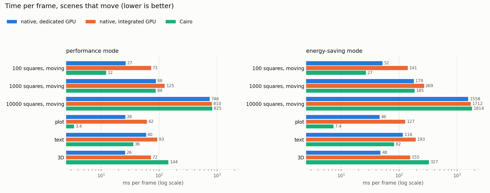
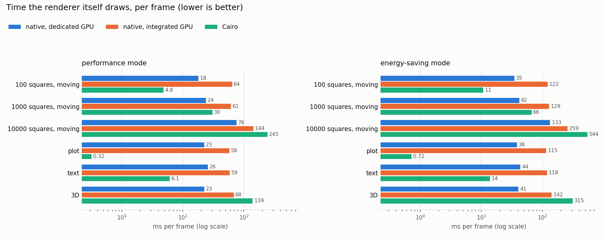
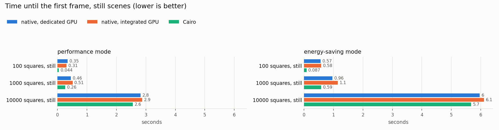
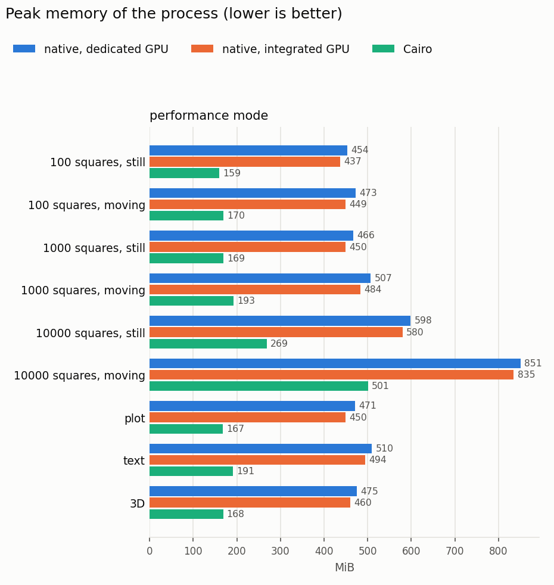

# Rendering benchmarks

How fast manim renders fixed scenes with the native wgpu renderer
(through the InsanityAdapter) compared with Cairo, the renderer of trunk
before it (commit `0041b6bb`). Everything here is made by three scripts
and can be made again on any machine:

| Script | What it does |
|---|---|
| [`scripts/benchmark_render.py`](../scripts/benchmark_render.py) | Renders the scenes, prints a table, saves the numbers to `results/` |
| [`scripts/plot_benchmarks.py`](../scripts/plot_benchmarks.py) | Draws the plots in `plots/` from `results/` |
| [`scripts/summarize_profile.py`](../scripts/summarize_profile.py) | Prints where a py-spy profile spends its time |

## What is measured

Each scene is rendered in a process of its own through the public API:
`Scene.render()` with the output format `"none"`, so every frame is drawn
and nothing is written. 1920×1080 pixels, 30 frames per second, half a
second of animation (15 frames).

| Scene | What it measures |
|---|---|
| 100 / 1000 / 10000 squares, still | many objects, nothing moves (`wait`) |
| 100 / 1000 / 10000 squares, moving | many objects, all turn (`Rotate`) |
| plot | a `NumberPlane`, axes and three plots; one dot moves |
| text | twelve lines of `Text` written in (`Write`) |
| 3D | a `Torus` and a `Sphere`, lit; the camera turns |

Per scene:

- **ms per frame:** the wall time of `Scene.render()` divided by the
  frames drawn. It contains everything: manim's animation step, turning
  mobjects into what the renderer draws, and drawing.
- **draw ms:** the part the renderer itself spends drawing, without
  turning mobjects into what it draws.
  - Native renderer: the call `WgpuRenderer.render`. It resolves the
    render object tree, packs the GPU records, runs the GPU passes and
    reads the pixels back. Building the tree from mobjects (the adapter)
    is not in it.
  - Cairo: the `_CairoDrawingContext._display_*` calls, i.e. Cairo
    filling and stroking the paths. Turning mobjects into render objects
    (`extract`) is not in it.
- **first frame** of the still scenes: everything up to the first
  picture, including making the GPU device, compiling the shaders and
  building the pipelines.
- **peak MiB:** the largest resident memory of the process.

## Results

Intel Core Ultra 9 285H, NVIDIA GeForce RTX 5070 Laptop GPU (driver
610.57) as the dedicated GPU, Intel Arc 140T as the integrated GPU;
Linux 7.1, Python 3.13, wgpu 30.0.1. Each run pinned to one fast core
(`taskset -c 2`), in the laptop's performance and energy-saving modes.
The raw numbers are in [`results/`](results/).









Performance mode, milliseconds per frame (total / draw):

| Scene | native, dedicated GPU | native, integrated GPU | Cairo |
|---|---|---|---|
| 100 squares, moving | 27 / 18 | 73 / 64 | 12 / 4.8 |
| 1000 squares, moving | 88 / 24 | 125 / 61 | 88 / 30 |
| 10000 squares, moving | 746 / 76 | 810 / 144 | 825 / 245 |
| plot | 26 / 23 | 62 / 58 | 3.4 / 0.3 |
| text | 60 / 26 | 93 / 59 | 36 / 6.1 |
| 3D | 26 / 23 | 72 / 68 | 144 / 139 |

### What the numbers say

- **Drawing large and 3D scenes is much faster.** The native renderer
  draws 10000 turning squares 3× faster than Cairo and the 3D scene 6×
  faster; the 3D scene is 5× faster in total.
- **It has a fixed cost of about 20 ms per frame** on the dedicated GPU
  (35–40 ms in energy-saving mode), however little changes. Cairo keeps
  what does not move as a finished picture and draws only the moving dot
  of the plot scene: 0.3 ms against 23 ms. This fixed cost is the first
  thing to look at (rendering at 1080p with MSAA, waiting for the
  read-back).
- **The first frame costs about 0.3 s** (device, shaders, pipelines),
  against 0.04 s for Cairo. It is paid once per renderer.
- **With many objects, the renderer is not what takes the time.** In the
  10000-square scene, 90 % of each frame is manim's animation step and
  turning the mobjects into the render object tree; the py-spy profile
  puts 35 % in `interpolate` (the animation), 15 % in the adapter, about
  4 % in the native renderer. The same work dominates Cairo, so the
  totals end up equal.
- **The dedicated GPU is 2–3× faster** than the integrated one on small
  scenes; with many objects the difference shrinks, because the CPU
  decides.
- **Performance mode halves the time** of both renderers: most of it is
  CPU time, which energy-saving mode throttles.
- **The native renderer uses about 300 MiB more memory** (GPU driver,
  device, render targets).

## Running it

```sh
python scripts/benchmark_render.py                     # all scenes, this tree
python scripts/benchmark_render.py --scene plot --size 854x480
python scripts/benchmark_render.py --gpu low-power     # the integrated GPU (RenderConfig.gpu)
python scripts/benchmark_render.py --manim ../old-tree --python ../old-tree/.venv/bin/python
python scripts/plot_benchmarks.py                      # plots from results/
```

- **Another manim tree:** `--manim` and `--python` run the same scenes
  on another checkout with its own environment, for example trunk
  before the native renderer:
  `git worktree add ../old-tree 0041b6bb && (cd ../old-tree && uv sync)`.
- **The power mode** is read from the system (Linux: the ACPI platform
  profile) and saved with the results; switch it before a run.
  `plot_benchmarks.py` shows one panel per power mode and keeps the
  newest run per renderer, GPU and power mode.
- **Fast and slow cores:** pin the run (`taskset -c 2` on Linux) and
  compare only runs made the same way.

### Profiles

```sh
python scripts/benchmark_render.py --scene plot --profile py-spy
python scripts/summarize_profile.py benchmarks/py-spy/plot.json --match insanity
python scripts/benchmark_render.py --scene plot --profile memray
```

- **py-spy** samples the running process from outside: almost no
  overhead, no code changes. Its speedscope files open at
  https://www.speedscope.app. `--native` also samples the Rust frames
  inside `manim._native`, but slows the run down a lot: use it on small
  scenes. Install it with `uv tool install py-spy`.
- **memray** records every allocation, of Python and native code (Rust,
  numpy), and writes a flame graph as HTML. It must be installed in the
  benchmarked tree's Python (`uv pip install --python .venv/bin/python
  memray`).

Profiles are written to `benchmarks/py-spy/` and `benchmarks/memray/`
and are not committed (they are large); the results and plots are.
