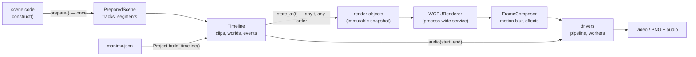
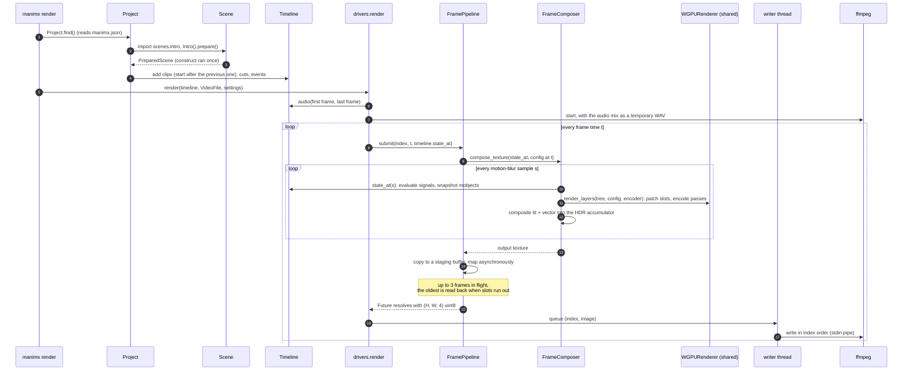
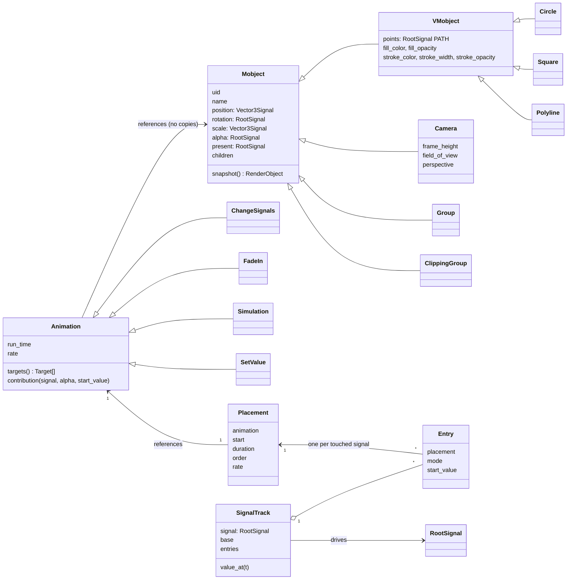
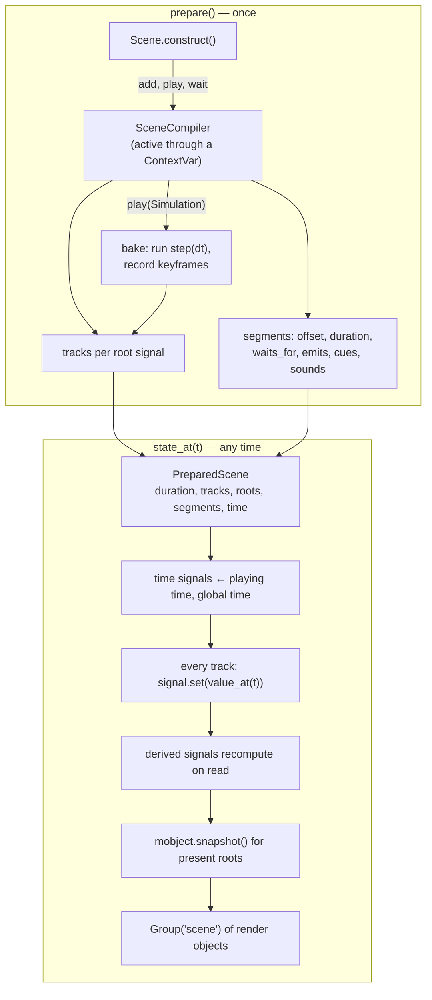
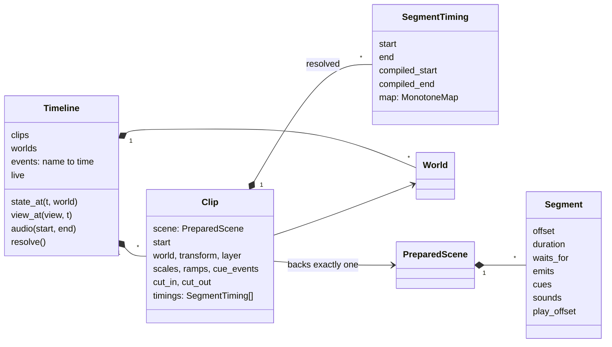
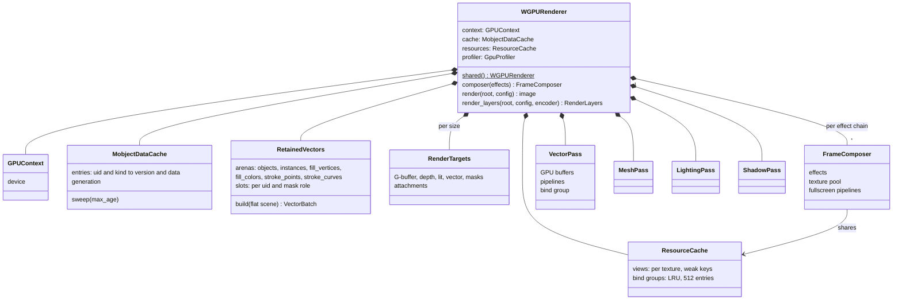
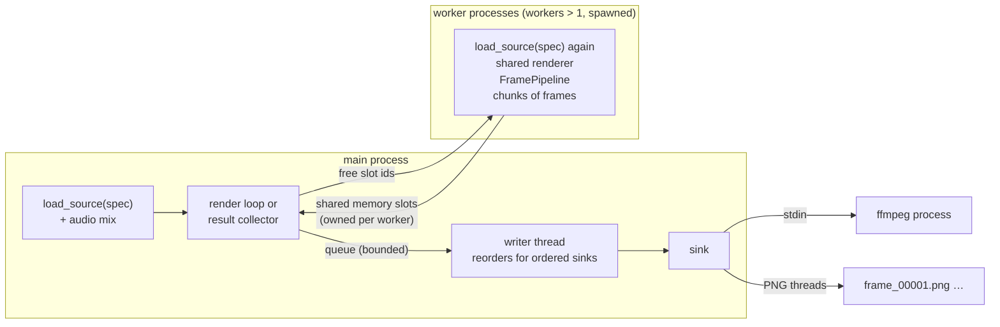
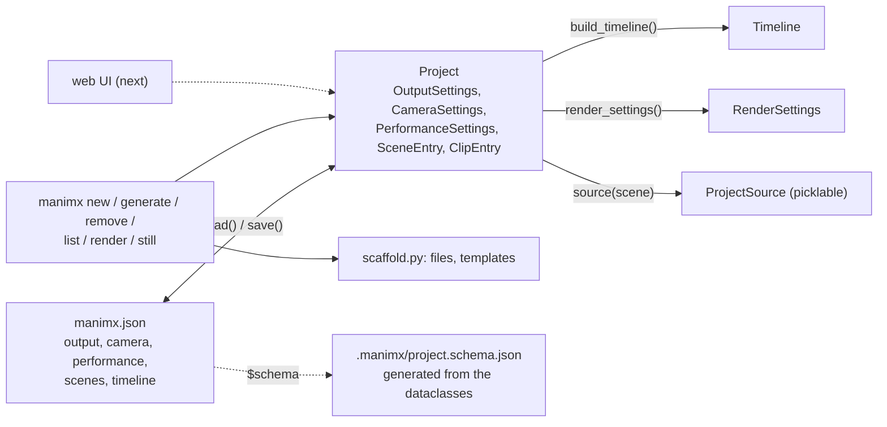

# manimx architecture

How manimx works as a whole: which objects exist, who creates and owns them,
how long they live, how data flows from scene code to pixels and sound, and
why it is built this way. The renderer's internals (passes, shaders, buffers)
are in [manimx/renderer/README.md](manimx/renderer/README.md); the animation
engine's design rationale is in `docs/animation_engine_design.md` (repository
root); performance work in [PERFORMANCE.md](PERFORMANCE.md); usage in
[GETTING_STARTED.md](GETTING_STARTED.md).

Contents:

1. [The big picture](#1-the-big-picture)
2. [Packages](#2-packages)
3. [From scene code to a video](#3-from-scene-code-to-a-video)
4. [The animation engine](#4-the-animation-engine)
5. [Timing: clips, segments, events and time maps](#5-timing-clips-segments-events-and-time-maps)
6. [Worlds, cameras, views](#6-worlds-cameras-views)
7. [Render objects: the contract between engine and renderer](#7-render-objects-the-contract-between-engine-and-renderer)
8. [The renderer service](#8-the-renderer-service)
9. [Drivers: frames, processes, sinks, audio](#9-drivers-frames-processes-sinks-audio)
10. [Projects and the CLI](#10-projects-and-the-cli)
11. [Lifetimes at a glance](#11-lifetimes-at-a-glance)
12. [Design decisions](#12-design-decisions)
13. [State of the work and next steps](#13-state-of-the-work-and-next-steps)

---

## 1. The big picture

manimx has two passes:

1. **Compile once.** Scene code (`construct()`) runs once and records what
   happens when: animations become placements on per-signal tracks,
   simulations are baked into keyframes, sounds and events are noted per
   segment. The result is a `PreparedScene`.
2. **Evaluate anywhere.** `state_at(t)` gives the render state at any time,
   in any order, in any process, without replaying anything. A renderer turns
   that state into pixels.

Everything else follows from this split: random access makes scrubbing,
retiming, cutting and parallel rendering possible. The renderer is a
long-lived service that keeps GPU data per object across all calls and only
patches what changed.

## 2. Packages

| Package | Role | Depends on |
|---|---|---|
| `manimx.objects` | render objects: `Group`, `ClippingGroup`, `Shape2D`, `Curve3D`, `Shape3D`, lights, materials, `Transform`; uid and versions | numpy |
| `manimx.animation` | signals, mobjects, animations, scenes, timing, worlds, cameras, simulations, audio | objects; `renderer.config` only for the plain `Camera`/`ViewState` types |
| `manimx.renderer` | backend-independent: scene graph flattening, tessellation, `MobjectDataCache`, config, effects | objects |
| `manimx.renderer.webgpu` | the WebGPU backend: `WGPURenderer`, `FrameComposer`, batches, passes, retained vector scene | wgpu |
| `manimx.drivers` | turn time into frames: `FramePipeline`, `render()`, worker processes, sinks | renderer, animation (for sources) |
| `manimx.project` | `manimx.json` ↔ `Project` objects ↔ `Timeline` | animation, drivers (settings) |
| `manimx.cli` | the `manimx` command (Typer, rich, questionary) | project, drivers |

The animation package never touches the GPU, and the renderer never knows
about signals or time: render objects are the only interface between them.

## 3. From scene code to a video

## 4. The animation engine

### 4.1 Signals

Every animatable property is a **signal**:

- **`RootSignal`**: holds a value set from outside, by authoring code,
  track evaluation or a simulation step.
- **`DerivedSignal`**: a pure function of other signals; this replaces
  Manim's updaters (`derive`, `follow`).
- **Kinds** say how values interpolate and combine: `SCALAR`, `FACTOR`
  (multiplicative), `ROTATION` (slerp), `COLOR`, `PATH` (point arrays),
  `DISCRETE`.
- **`Vector3Signal`**: three scalar roots, one per axis, so animations of
  different axes never interfere.
- **`TimeSignals`**: `scene_time` (stands still during holds) and
  `global_time` (always runs).

Propagation is push-invalidation with pull-evaluation: setting a root marks
its dependents dirty, and they recompute when read. Every signal has a
process-unique `id` and a `version` that increases exactly when its value
changes. Versions are the basis of all caching downstream.

### 4.2 Mobjects, animations, tracks

- **Animations reference their mobjects** and never copy them. An
  animation declares which signals it touches (`targets()`) and what it
  contributes at a given progress (`contribution()`, a pure function).
- **Placements:** `play()` creates one `Placement` per animation, with its
  start, duration, authoring order and rate function.
- **Tracks:** each touched root signal gets a `SignalTrack`, which holds one
  `Entry` per placement. `value_at(t)` folds the entries in authoring order:
  relative changes add up, absolute ones override, starting from the value
  the signal had when the animation began.
- **Direct edits during `construct()`** become instant `SetValue`
  placements, so `square.shift(RIGHT)` between two plays does not rewrite
  the square's past (authoring.py).

### 4.3 Compilation and evaluation

- **Evaluation sets signals and reads them back.** A prepared scene's
  mobjects and signals are its evaluation state, which is why one prepared
  scene can back only one clip.
- **Purity:** the result of `state_at(t)` depends only on `t`; earlier calls
  only change which caches hit.
- **Snapshots** build new render objects every time. They keep the
  mobject's uid and carry version tokens derived from the signals (section
  7), so the renderer recognizes unchanged data.

### 4.4 Simulations

A `Simulation` is the user's `step(dt)` function, which changes mobjects
however it likes. It is baked when `play()` places it:
- it runs at a fixed step from start to end;
- other animations of the same `play` call are fed in as inputs before
  every step;
- every signal the step changes is recorded at `keyframe_rate`.

Afterwards it is an ordinary absolute animation that interpolates its
keyframes. Its `emit` and `play_wave` calls become segment events and
sounds at the simulated time. There is no built-in physics engine; this is
deliberate.

### 4.5 Audio

A `Sound` is float32 samples, mono or stereo, plus a rate, loaded from a
file (WAV directly, anything else through ffmpeg) or made from an array.
`play_sound`/`play_wave` record a `SoundEvent` in the current segment
without moving the cursor. Mixing happens late, per timeline: each sound
starts at the global time its scene point is shown and then plays at its own
speed, so time maps never change pitch.

## 5. Timing: clips, segments, events and time maps

- **Segments:** `wait_for(event)` ends a segment. Segments sit on one
  compiled time axis, separated by a gap that is never shown. The playing
  time is compiled time without those gaps.
- **Events:** they come from `Timeline.events` (fixed times, clicks) or from
  `emit` in any clip. Resolution iterates to a fixed point: each segment
  starts at its event, or when the previous segment ends if that is later.
  While editing it is lenient; `resolve()` is strict, and live mode holds on
  events that have not fired.
- **Time maps:** each placed segment maps global time to compiled time
  through a monotone cubic (PCHIP) through knots: the start, every cue whose
  event is known (so a cue lands exactly on its word), the edges of
  slow-motion ramps, and the end. Time never runs backwards and speed
  changes smoothly.
- **Lazy resolution:** clip edits (`cut`, `slow_motion`, `bind_cue`,
  `set_scale`, `place`) mark the timeline dirty, and the next query
  resolves it once.

## 6. Worlds, cameras, views

- **Worlds:** each clip plays in one world. A `World3D` is a space seen
  through cameras. A `World2D` is a flat z = 0 canvas for HUDs and
  compositions, where clips may only move in the plane. `state_at(t, world)`
  renders one world.
- **Cameras:** a `Camera` is a mobject with signals for position, rotation,
  `frame_height` and field of view, animated like anything else (camera
  scenes). It is never drawn. Outside its clip a camera keeps its first or
  last placement.
- **Views:** a `View` pairs a world with a camera. `timeline.view(view)` is
  a function of time returning a `ViewState(root, camera)`, which the
  composer uses for every motion-blur sample, so camera moves blur too.
- **Compositions** (views shown as images inside a `World2D`) come next and
  are not built yet.

## 7. Render objects: the contract between engine and renderer

`manimx.objects` defines the render state, the only thing that crosses from
the engine to the renderer. These rules make every renderer cache correct:

1. **Stable identity:** every snapshot of one mobject has the same `uid`,
   and uids are never reused within a process.
2. **Versions:** a field declared with `versioned()` (points, fill, stroke,
   mesh) has a token. Snapshots set tokens from the signals the field was
   computed from, so equal tokens promise equal values. Transforms are not
   versioned; they are compared directly.
3. **Immutability:** a snapshot is never mutated after it is returned, and
   versioned arrays are read-only.
4. **Purity:** `state_at` has no side effects on its result. Caches may
   speed it up, but never change it.
5. **Lifecycle:** objects leaving for good can be announced with
   `RemoveObjects`. Otherwise the renderer's caches age entries out
   (section 8).

## 8. The renderer service

**One renderer per process.** `WGPURenderer.shared()` creates the device,
pipelines and caches once. Drivers, the CLI and tests render through it.
Rendering is single-threaded per renderer.

**What a render does.** With the per-object data, the work depends on
what changed:

| Step | Unchanged objects | Changed objects |
|---|---|---|
| `flatten_scene` | world matrices, painter's order, clip scopes, lights (every render) | same |
| `RetainedVectors.build` | nothing written (slot keyed by uid and mask role) | new matrix: 80-byte entry; new style: records in place; new points: records moved, curves and instances rewritten |
| `MobjectDataCache` | hit: tessellation, stroke topology and points, center, mesh vertices | rebuilt for the new version |
| Upload | nothing | only the written record ranges |
| 3D stages | skipped entirely while a frame has no meshes (G-buffer and lit layer cleared once) | run |
| Passes | masks, (shadows, geometry, lighting), vectors, all recorded into the composer's encoder | |

**Caches and their lifetimes:**

| Cache | Key | Lives until |
|---|---|---|
| `MobjectDataCache` | (uid, kind) → (version, data) | replaced on a version change; dropped after 1024 renders unused, or by `RemoveObjects`/`ClearScene` |
| `RetainedVectors` slots | (uid, mask role) | freed when the shape is absent from a render; arenas repacked when garbage outweighs live records |
| `ResourceCache` views | per texture (weak key) | with their texture |
| `ResourceCache` bind groups | layout + identities of the bound resources | LRU, 512 entries |
| `RenderTargets` | size, MSAA, mask capacity | replaced on a size change |
| Composers | effect chain | the renderer |
| Pipelines, shaders | variant | the renderer |

**The frame composer.** Per frame and per motion-blur sample:
- evaluate the scene at the sample's time;
- render the layers;
- apply the lit-stage effects (bloom, shader effects);
- composite the lit and vector layers over the background into an HDR
  accumulator, weighted by the sample;
- record one encoder and submit once per sample.

At the end it applies the frame-stage effects and encodes to sRGB in the
output texture.

## 9. Drivers: frames, processes, sinks, audio

- **`FramePipeline`:** keeps up to `in_flight` frames on the GPU. Each
  frame is copied into its own staging buffer and mapped asynchronously.
  `submit()` returns a `Future`, resolved in submission order.
- **Workers:** each worker rebuilds the source from its name
  (`"module:Class"` or a picklable `ProjectSource`). Purity makes the frames
  identical across processes. Frames come back through shared memory slots
  owned per worker. A worker renders its frames in increasing order and
  waits only for its own slots, so in-order writing cannot deadlock.
- **Sinks:** `VideoFile` (ffmpeg, with the audio mix muxed in the same
  pass), `ImageSequence` (PNG plus `audio.wav`), `FrameList`. Ordered sinks
  get frames in index order.
- **Audio:** the main process mixes exactly the rendered range before
  rendering starts. Sources without sounds get no audio track.

## 10. Projects and the CLI

- **The object state is the source of truth.** `manimx.json` is its
  snapshot: code, the CLI and later the web UI edit the same `Project`
  objects and save them. Scenes stay code; the project references them by
  module and class.
- **Loading is strict.** Unknown keys come with a "did you mean" hint, and
  types and minimums are checked. The schema is generated from the same
  dataclasses that load the file.
- **The timeline in the file** is a list of clips in order. A clip without
  `start` begins when the previous clip ends.
- **Scene modules are imported one at a time** from the registry, so a
  broken scene never breaks the others. A package of the same name from
  another project is evicted from `sys.modules` first.
- **The CLI** (Typer, rich, questionary) prompts only for missing arguments
  in a terminal. Errors are panels with a hint, plus a traceback of the
  user's frames when scene code fails.

## 11. Lifetimes at a glance

| Object | Created by | Owned by | Lives until | Mutable? |
|---|---|---|---|---|
| `Mobject` and its signals | scene code in `construct()` | the `PreparedScene` (roots, tracks) | the prepared scene | signal values change on every evaluation |
| `SceneCompiler` | `Scene.prepare()` | the ContextVar while `construct()` runs | the end of `prepare()` | yes |
| `PreparedScene` | `Scene.prepare()` (cached in `Scene`) | one `Clip` | the timeline or project build | evaluation state only |
| `SignalTrack`, `Placement`, `Entry` | `play()` and direct edits | the prepared scene | the prepared scene | `refresh()` after edits |
| `Segment`, `Emit`, `Cue`, `SoundEvent` | `wait_for`, `emit`, `cue`, `play_sound` | the prepared scene | the prepared scene | no (frozen) |
| `Timeline`, `Clip`, `World` | code, or `Project.build_timeline()` | the caller, later the session | the caller | yes; edits mark the timeline dirty |
| `SegmentTiming`, `MonotoneMap` | timeline resolution | the `Clip` | the next resolution | no |
| Render objects | `state_at` snapshots | the caller of `state_at` | that render | no |
| `Project` | `Project.load/find`, CLI | the CLI command (later the UI) | the command | yes; `save()` writes it |
| `WGPURenderer` | `WGPURenderer.shared()` | the process | the process | caches inside |
| `FrameComposer` | `renderer.composer(effects)` | the renderer | the renderer | texture pool inside |
| `FramePipeline` | `drivers.render()` | the render call | the call (staging buffers) | yes |
| Writer thread, worker processes, ffmpeg | `drivers.render()` | the render call | the call | |

## 12. Design decisions

The decisions that shape the code, with their reasons.

**Animation**

- **Two passes: compile once, evaluate anywhere.** Random access is what
  makes scrubbing, retiming, cuts, previews, motion blur and parallel
  workers simple. Replaying from the start on every query would rule them
  out.
- **Signals everywhere, one per axis.** Animations on different properties
  or axes compose without interfering. Derived signals replace updaters with
  pure functions, which keeps evaluation deterministic.
- **Animations reference mobjects; no target copies.** An animation is a
  pure function of progress, placed on the timeline. Composition rules
  (relative changes add, absolute ones override from the start value) live
  in the tracks.
- **Direct edits during `construct()` happen at that moment** (instant
  placements), and reads return the state after everything recorded so far,
  so code reads like Manim but never rewrites the past.
- **Versions, not hashes.** Change counters cost nothing per frame. A
  revisited time costs one recomputation and is never wrong.

**Timing**

- **Events, holds and cues are names in scene code; times come from the
  timeline.** Scenes stay reusable, and clicks, transcripts and other clips
  bind the times.
- **PCHIP time maps.** They pass exactly through each cue, never run
  backwards, and change speed smoothly.
- **Sounds are never retimed.** Slow motion moves sound starts apart, but
  pitch stays.

**Simulations**

- **Baked, not run live.** Rendering stays random access and parallel. The
  user writes a step function; there is no engine dependency. Animated
  objects are inputs, and reactions go through derived signals, events and
  sounds.

**Render contract**

- **uid plus version tokens are the only change detection.** The renderer
  never deep-compares data. Everything from tessellation caches to retained
  GPU slots uses the same keys.

**Renderer**

- **The renderer is a process-wide service.** Device, pipelines, buffers,
  targets, views, bind groups and per-object data survive across calls. That
  is what makes a long-lived web UI cheap.
- **Retained vector scene.** Per-object records stay in GPU-mirroring
  arenas and are patched, with only changed ranges uploaded. The cost per
  render follows what changed, not the scene size.
- **Mesh-free frames skip the 3D stages.** Most Manim content is 2D, and the
  deferred pipeline costs nothing when unused.
- **Motion blur is exact sub-frame rendering.** Any change blurs correctly,
  including camera moves and appearing objects.

**Drivers**

- **Pipelined GPU frames, a writer thread, worker processes.** The GPU, the
  CPU, the encoder and the disk all work at the same time.
- **Workers rebuild the source from a name.** Purity guarantees identical
  frames, and spawn is used because GPU devices do not survive fork.

**Projects**

- **`manimx.json` is a snapshot of `Project` objects.** One API for code,
  CLI and UI, with no separate intermediate representation and no override
  layers.
- **Strict loading with a generated schema.** Typos fail loudly, and editors
  can check the file.

**Performance policy**

- **Only measured improvements stay.** Every optimization is benchmarked
  (`scripts/benchmark_project.py`), checked bit-identical against reference
  frames, and recorded in PERFORMANCE.md, including what was dropped.

## 13. State of the work and next steps

**Done:**
- signals, animations, scenes;
- segments, events, cues and time maps;
- worlds, clips, cameras and views;
- simulations, audio (mono and stereo, files and arrays);
- the offline driver with workers;
- projects and the CLI, the example project and GETTING_STARTED.md;
- performance work: 74.5 → 169.8 fps on the example project, 2.3× faster
  than the baseline.

**Next, in the agreed order:**
1. **Web UI:** scrubbing preview, editing the timeline on the `Project`
   objects, live presentation with clicks firing events.
2. **Compositions:** views shown as images in a `World2D`, nesting.
3. **HDR colors for 2D:** a float vector layer and bloom on 2D shapes,
   while colors ≤ 1 stay exactly Manim's.
4. **Morphing** (`Transform`, path alignment), and Whisper transcripts bound
   to cues.
5. **Usability and performance, full time.** The remaining cost is CPU:
   per-render Python bookkeeping (flatten, slot diff, draw lists) and
   `state_at`. The GPU needs about 1.7 ms of 5.9 ms per frame.
6. **miette-style diagnostics**, once the common errors are known.

**Working conventions:**
- Commits are kernel style, with the design decisions in the message and
  no self-attribution. Commit only `manimx/`; `docs/`, the root
  `pyproject.toml` and the root `uv.lock` belong to the user and stay out
  of commits.
- Tests: `uv run --active pytest` in `manimx/`, with coverage at least 90%.
- Benchmark: check the power mode, run `scripts/benchmark_project.py
  example-project --check-reference <ref.npz>`, report.
- Don't run `ruff check` without `--no-fix`: the project config fixes files
  in place.
