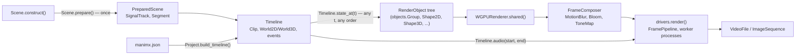
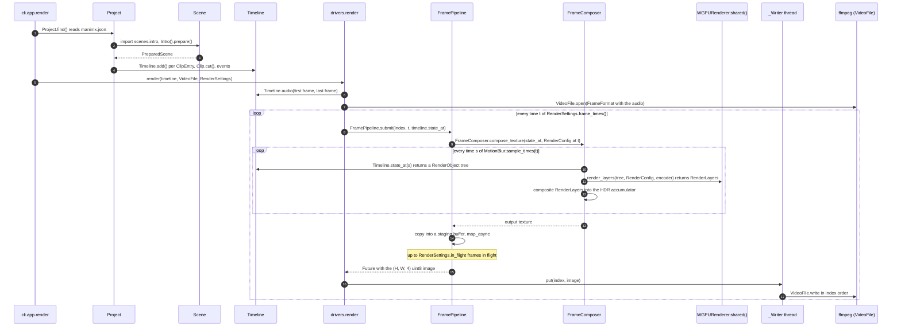
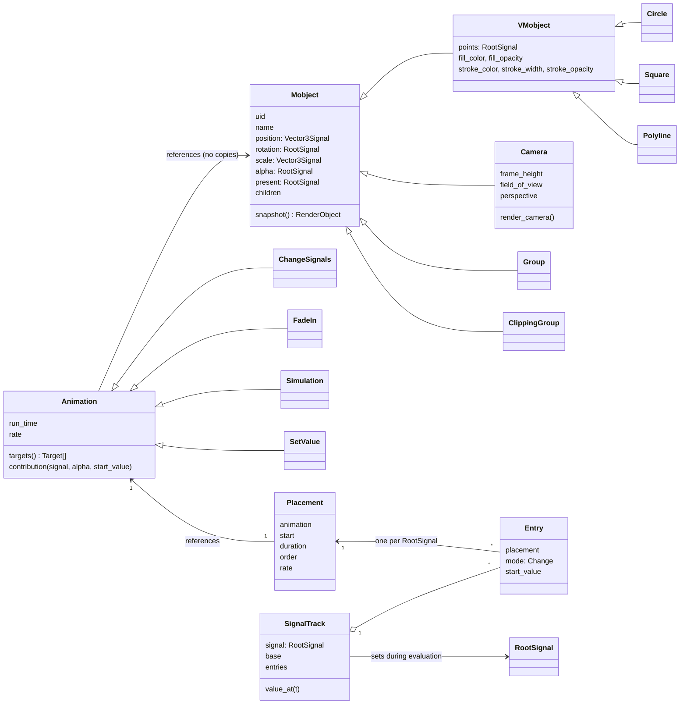
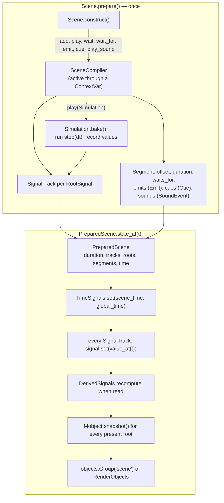
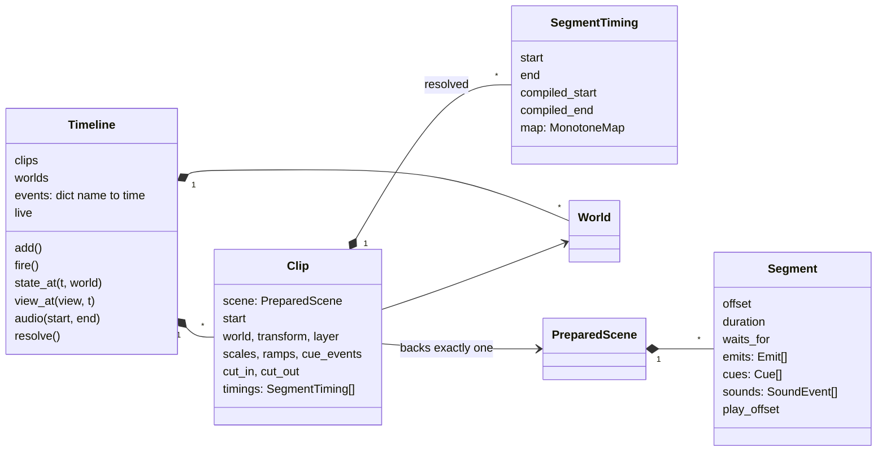
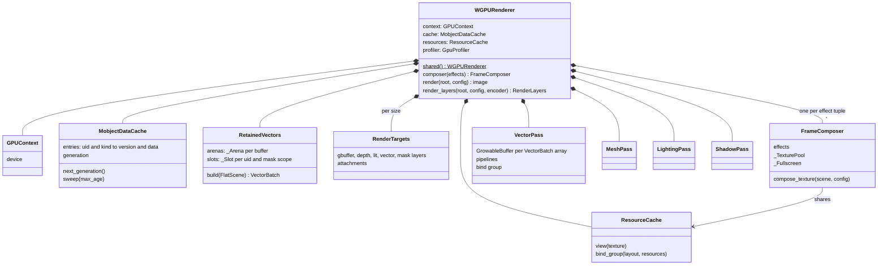
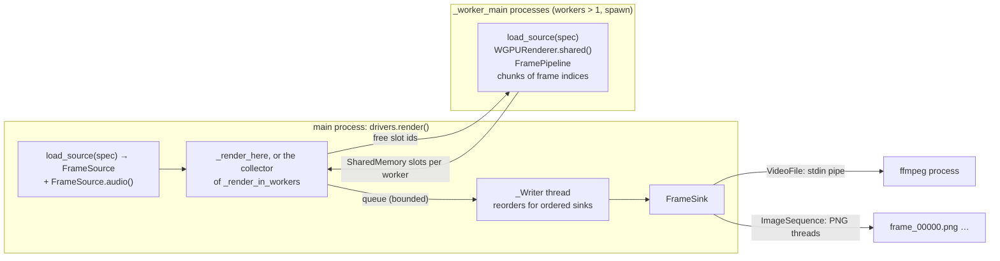
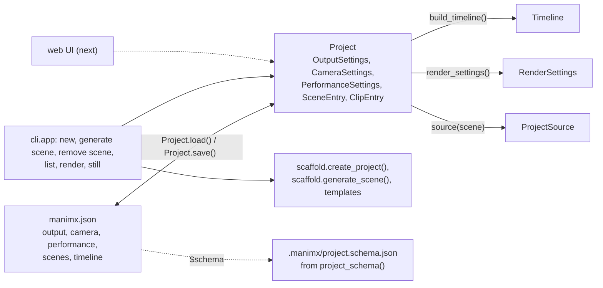

# manimx architecture

How manimx works as a whole: which classes exist, who creates and owns their
instances, how long they live, how data flows from `Scene.construct()` to
pixels and sound, and why it is built this way. Everything is named as in
the Python code. Where two classes share a name, the module comes first
(`animation.Group` is a `Mobject`, `objects.Group` a `RenderObject`).

More detail: the renderer's internals (passes, shaders, buffers) in
[manimx/renderer/README.md](manimx/renderer/README.md), the animation
engine's design rationale in `docs/animation_engine_design.md` (repository
root), performance work in [PERFORMANCE.md](PERFORMANCE.md), usage in
[GETTING_STARTED.md](GETTING_STARTED.md).

Contents:

1. [The big picture](#1-the-big-picture)
2. [Packages](#2-packages)
3. [From `Scene.construct()` to a video](#3-from-sceneconstruct-to-a-video)
4. [The animation package](#4-the-animation-package)
5. [Timing: `Timeline`, `Clip`, `Segment`, `MonotoneMap`](#5-timing-timeline-clip-segment-monotonemap)
6. [`World2D`, `World3D`, `animation.Camera`, `View`](#6-world2d-world3d-animationcamera-view)
7. [`RenderObject`: the contract between both sides](#7-renderobject-the-contract-between-both-sides)
8. [`WGPURenderer` as a service](#8-wgpurenderer-as-a-service)
9. [Drivers: `FramePipeline`, processes, `FrameSink`, audio](#9-drivers-framepipeline-processes-framesink-audio)
10. [`Project` and the CLI](#10-project-and-the-cli)
11. [Lifetimes at a glance](#11-lifetimes-at-a-glance)
12. [Design decisions](#12-design-decisions)
13. [State of the work and next steps](#13-state-of-the-work-and-next-steps)

---

## 1. The big picture

manimx has two passes:

1. **Compile once.** `Scene.prepare()` runs `Scene.construct()` once and
   records what happens when:
   - every `Animation` gets a `Placement` and one `Entry` on the
     `SignalTrack` of each `RootSignal` it changes;
   - every `Simulation` is baked into recorded values;
   - every `Emit`, `Cue` and `SoundEvent` is stored in its `Segment`.

   The result is a `PreparedScene`.
2. **Evaluate anywhere.** `PreparedScene.state_at(t)` and
   `Timeline.state_at(t)` return a tree of `RenderObject`s for any time, in
   any order and in any process, without replaying anything.
   `WGPURenderer` turns such a tree into pixels.

Everything else follows from this split: random access makes scrubbing,
retiming, cutting and parallel rendering possible. `WGPURenderer` is a
long-lived service that keeps GPU data per `RenderObject.uid` across all
calls and only patches what changed.

## 2. Packages

| Package | Contents | Depends on |
|---|---|---|
| `manimx.objects` | `RenderObject` and its subclasses `objects.Group`, `objects.ClippingGroup`, `BezierPath` (→ `Shape2D`, `Curve3D`), `Shape3D`, `Light` (→ `DirectionalLight`, `PointLight`, `SpotLight`); `Transform`, `Fill`, `Stroke`, `MeshData`, `PbrMaterial`, `Texture`; `new_uid()`, `versioned()` | numpy |
| `manimx.animation` | `RootSignal`, `DerivedSignal`, `Vector3Signal`, `TimeSignals`; `Mobject` and its subclasses; `Animation` and its subclasses; `Scene`, `SceneCompiler`, `PreparedScene`; `Timeline`, `Clip`; `World2D`, `World3D`, `animation.Camera`, `View`; `Simulation`; `Sound` | objects; from `manimx.renderer` only the dataclasses `renderer.Camera` and `ViewState` |
| `manimx.renderer` | `flatten_scene()` → `FlatScene`; `tessellate_fill()`; `MobjectDataCache`; `RenderConfig`, `renderer.Camera`, `ViewState`; `MotionBlur`, `Bloom`, `ToneMap`, `ShaderEffect`; `RemoveObjects`, `ClearScene` | objects |
| `manimx.renderer.webgpu` | `WGPURenderer`, `FrameComposer`, `RetainedVectors`, `VectorBatch`, `MeshBatch`, `VectorPass`, `MeshPass`, `LightingPass`, `ShadowPass`, `RenderTargets`, `RenderLayers`, `ResourceCache`, `GPUContext` | wgpu |
| `manimx.drivers` | `render()`, `FramePipeline`, `RenderSettings`, `FrameSource`, `load_source()`; `FrameSink` (→ `VideoFile`, `ImageSequence`, `FrameList`) | renderer, animation |
| `manimx.project` | `Project`, `OutputSettings`, `CameraSettings`, `PerformanceSettings`, `SceneEntry`, `ClipEntry`, `ProjectSource` | animation, drivers |
| `manimx.cli` | the Typer `app` (`manimx` command), `scaffold`, `ui` | project, drivers |

`manimx.animation` never touches the GPU, and `manimx.renderer` never sees a
`RootSignal` or a time: `RenderObject` trees are the only interface between
them.

## 3. From `Scene.construct()` to a video

## 4. The animation package

### 4.1 Signals

Every animatable property of a `Mobject` is a signal:

- **`RootSignal`**: holds a value set from outside, by `authoring.change()`,
  by `SignalTrack.value_at()` during evaluation, or by a `Simulation` step.
- **`DerivedSignal`**: a pure function of other signals, created with
  `derive()` (and `Mobject.follow()`). It replaces Manim's updaters.
- **`SignalKind`** instances say how values interpolate and combine:
  `SCALAR`, `FACTOR`, `ROTATION` (slerp), `COLOR`, `PATH` (point arrays),
  `DISCRETE`.
- **`Vector3Signal`**: three `RootSignal`s `x`, `y`, `z`, so animations of
  different axes never interfere.
- **`TimeSignals`**: `scene_time` (stands still while a `Segment` waits) and
  `global_time` (always runs).

Setting a `RootSignal` invalidates its dependents; a `DerivedSignal`
recomputes when it is read. Every signal has a process-unique `id` and a
`version` that increases exactly when its value changes. Versions drive all
caching downstream.

### 4.2 `Mobject`, `Animation`, `SignalTrack`

`Group`, `ClippingGroup` and `Camera` in this diagram are the
`manimx.animation` classes.

- **An `Animation` references its `Mobject`s** and never copies them.
  `Animation.targets()` names the `RootSignal`s it changes, each with a
  `Change` (`RELATIVE` or `ABSOLUTE`). `Animation.contribution()` is a pure
  function of the progress.
- **`Scene.play()`** creates one `Placement` per `Animation`, with its start,
  duration, authoring order and rate function.
- **Every `RootSignal` an `Animation` changes** gets a `SignalTrack` with
  one `Entry` per `Placement`. `SignalTrack.value_at(t)` folds the entries in
  authoring order: `RELATIVE` contributions combine, `ABSOLUTE` ones
  override, starting from `Entry.start_value`.
- **A direct call such as `square.shift(RIGHT)` inside `construct()`**
  becomes a `SetValue` placement at the current cursor
  (`authoring.change()`), so it does not rewrite the square's past.

### 4.3 `Scene.prepare()` and `PreparedScene.state_at()`

- **Evaluation sets the `RootSignal`s and reads them back**, so a
  `PreparedScene`'s `Mobject`s are its evaluation state. That is why one
  `PreparedScene` backs only one `Clip`.
- **Purity:** the result of `state_at(t)` depends only on `t`.
- **`Mobject.snapshot()`** builds new `RenderObject`s on every call
  (`VMobject` → `Shape2D`, `animation.Group` → `objects.Group`,
  `animation.ClippingGroup` → `objects.ClippingGroup`, `animation.Camera` →
  nothing). Each keeps the `Mobject.uid` and carries version tokens from
  `version_token()` (section 7).

### 4.4 `Simulation`

A `Simulation` wraps the user's `step(dt)` function, which changes
`Mobject`s however it likes. `SceneCompiler.play()` bakes it with
`Simulation.bake()`:

- `step` runs at the fixed step `dt` from start to end;
- before every step, each `RootSignal` with a `SignalTrack` from the same
  `play()` call (or earlier) is set to its value at that time;
- every `RootSignal` the step changes is recorded at `keyframe_rate`, in
  `Simulation.times` and the recorded values.

Afterwards the `Simulation` is an `ABSOLUTE` `Animation` that interpolates
the recorded values. `Simulation.emit()` and `Simulation.play_wave()` add an
`Emit` and a `SoundEvent` at the simulated time. There is no built-in physics
engine; this is deliberate.

### 4.5 `Sound`

A `Sound` holds float32 samples (`(count, 1)` or `(count, 2)`) and a
`sample_rate`. It comes from `Sound.load()` (WAV directly, anything else
through ffmpeg) or from an array. `Scene.play_sound()` and
`Scene.play_wave()` record a `SoundEvent` in the current `Segment` without
moving the cursor. `Timeline.audio()` (via `Clip.placed_sounds()` and
`mix()`) starts each `Sound` at the global time its point in the scene is
shown, then plays it at its own speed, so a `MonotoneMap` never changes its
pitch.

## 5. Timing: `Timeline`, `Clip`, `Segment`, `MonotoneMap`

- **`Segment`:** `Scene.wait_for(name)` closes a `Segment`. Segments lie on
  one compiled time axis, separated by `SEGMENT_GAP`, which is never shown.
  `Segment.play_offset` counts the time without those gaps.
- **Event names:** they get their times from `Timeline.events`
  (`Timeline.fire()`) or from an `Emit` in any `Clip`.
  `Timeline._resolve()` iterates to a fixed point: a `Segment` starts at the
  time of its `waits_for` event, or when the previous one ends if that is
  later. While editing, resolution is lenient. `Timeline.resolve()` is
  strict and raises `UnresolvedEvents` or `InvalidCue`. With
  `Timeline.live`, unfired events hold.
- **`MonotoneMap`:** each `SegmentTiming` maps global time to compiled time
  with a monotone cubic (PCHIP) through these knots:
  - the start;
  - every `Cue` whose event is known, so the cue lands exactly on it;
  - the edges of every `Ramp` (`Clip.slow_motion()`);
  - the end.
- **Lazy resolution:** `Clip.cut()`, `Clip.slow_motion()`,
  `Clip.bind_cue()` and `Clip.set_scale()` mark the `Timeline` dirty, and the
  next query resolves it once.

## 6. `World2D`, `World3D`, `animation.Camera`, `View`

- **`World2D` and `World3D`:** every `Clip` has one `Clip.world`.
  `World2D.check_transform()` keeps its clips in the z = 0 plane.
  `Timeline.state_at(t, world)` returns one world's `objects.Group`.
- **`animation.Camera`:** a `Mobject` whose `RootSignal`s are `position`,
  `rotation`, `frame_height`, `field_of_view` and `perspective`; it is
  animated like any other `Mobject`. `snapshot()` returns `None`.
  `Timeline.camera_at()` evaluates its `Clip` at `Clip.held_time()`, so it
  keeps its first and last placement outside the clip.
  `animation.Camera.render_camera()` returns a `renderer.Camera`.
- **`View(world, camera)`:** `Timeline.view(view)` is a function of time
  returning `ViewState(root, camera)`. `FrameComposer` uses
  `ViewState.camera` for every motion-blur sample.
- **Showing a `View` inside a `World2D`** (compositions) is not built yet.

## 7. `RenderObject`: the contract between both sides

`RenderObject` (`manimx.objects`) is the only thing that crosses from
`manimx.animation` to `manimx.renderer`. These rules make every renderer
cache correct:

1. **`RenderObject.uid`:** every snapshot of one `Mobject` has the
   `Mobject.uid`. `new_uid()` never repeats within a process.
2. **Versions:** fields declared with `versioned()` (`BezierPath.points`,
   `BezierPath.stroke`, `Shape2D.fill`, `Shape3D.mesh`) have a token,
   `RenderObject.version(name)`. `VMobject.snapshot()` passes tokens from
   `version_token()` of the `RootSignal`s, so equal tokens mean equal
   values. `RenderObject.transform` is not versioned; it is compared
   directly.
3. **Immutability:** a `RenderObject` is never changed after `state_at`
   returns it, and versioned arrays are read-only.
4. **Purity:** `state_at` has no side effects on its result.
5. **Lifecycle:** `renderer.submit(RemoveObjects(...))` drops the data of
   objects gone for good. Otherwise `MobjectDataCache.sweep()` ages entries
   out (section 8).

## 8. `WGPURenderer` as a service

**One `WGPURenderer` per process:** `WGPURenderer.shared()` creates the
`GPUContext`, the pipelines and the caches once. `drivers.render()`, the CLI
and the tests use it. One thread renders at a time.

**What `WGPURenderer.render_layers()` does:**

| Step | `RenderObject` unchanged | `RenderObject` changed |
|---|---|---|
| `flatten_scene()` → `FlatScene` (`DrawItem`s with world matrices and painter's order, `ClipScope`s, `LightItem`s) | every call | every call |
| `RetainedVectors.build()` for `Shape2D` and `Curve3D` | nothing written to its `_Slot` | new world matrix: the 80-byte object entry; new `fill`/`stroke` version: its records in place; new `points` version: records moved, curves and instances rewritten |
| `MobjectDataCache` (`tessellate_fill()` result, stroke records, center, `Shape3D` vertices) | hit | rebuilt for the new version |
| `GrowableBuffer.write()` | nothing uploaded | only the written record ranges |
| `MeshBatch.build()`, `build_shadow_views()`, geometry and lighting passes | skipped while the `FlatScene` contains no `Shape3D` (G-buffer and lit target cleared once) | run when a `Shape3D` is present |
| Mask, shadow and vector passes | recorded into the `FrameComposer`'s command encoder | same |

**Caches and their lifetimes:**

| Cache | Key | Lives until |
|---|---|---|
| `MobjectDataCache` | (uid, kind) with a version | replaced on a new version; dropped after 1024 renders unused (`sweep()`), or by `RemoveObjects` / `ClearScene` |
| `RetainedVectors._Slot` | (uid, mask scope) | freed when its `RenderObject` is missing from a render; `_Arena`s repacked when garbage outweighs live records |
| `ResourceCache.view()` | the texture (weak key) | its texture |
| `ResourceCache.bind_group()` | the layout plus the identities of the bound resources | LRU, 512 entries |
| `RenderTargets` | size, MSAA samples, mask capacity | the next size change |
| `FrameComposer` | the tuple of effects | the `WGPURenderer` |
| pipelines and shader modules | variant | the `WGPURenderer` |

**`FrameComposer.compose_texture()`**, for every time of
`MotionBlur.sample_times(t)` (or just `t`):
- calls the scene function;
- calls `WGPURenderer.render_layers()`;
- applies `Bloom` and `ShaderEffect(stage="lit")` to `RenderLayers.lit`;
- composites `RenderLayers.lit` and `RenderLayers.vector` over the background
  into the HDR accumulator, weighted by the sample (`ToneMap` for the lit
  part);
- submits one command encoder per sample.

Finally it applies `ShaderEffect(stage="frame")` and encodes to sRGB in the
output texture.

## 9. Drivers: `FramePipeline`, processes, `FrameSink`, audio

- **`FramePipeline`:** keeps up to `in_flight` frames on the GPU, with one
  staging buffer per frame mapped through `map_async`. `submit()` returns a
  `concurrent.futures.Future`, completed in submission order.
- **Worker processes:** each runs `_worker_main`, which rebuilds the source
  with `load_source()` from a `"module:Class"` string or a `ProjectSource`.
  Because `state_at` is pure, every process renders identical frames.
  Frames come back through `SharedMemory` slots owned per worker. A worker
  renders its frames in increasing order and waits only for its own slots,
  so in-order writing cannot deadlock.
- **`FrameSink`s:**
  - `VideoFile` runs ffmpeg and muxes the audio from `FrameFormat.audio`
    in the same pass;
  - `ImageSequence` writes PNG files plus `audio.wav`;
  - `FrameList` keeps the frames in memory.

  Sinks with `ordered = True` get frames in index order.
- **Audio:** `FrameSource.audio(start, end, sample_rate)` (from
  `Timeline.audio` or `PreparedScene.audio`) mixes exactly the rendered range
  before rendering starts. A silent mix means no audio track.

## 10. `Project` and the CLI

- **`Project` holds the state; `manimx.json` is its snapshot.** Code, the
  CLI and later the web UI change the same `Project` and call
  `Project.save()`. A `SceneEntry` references a `Scene` subclass by module
  and class.
- **`Project.load()` is strict.** It rejects unknown keys with a "did you
  mean" hint and checks types and minimums. `project_schema()` derives the
  schema from the same dataclasses (`OutputSettings`, `CameraSettings`,
  `PerformanceSettings`).
- **`Project.build_timeline()`** prepares every `ClipEntry`'s scene and
  calls `Timeline.add()`. A `ClipEntry` without `start` begins at the
  previous `Clip.end`.
- **`Project.scene_class()`** imports each scene module on its own, so a
  broken module only fails its own `SceneEntry`. A package of the same name
  from another project is evicted from `sys.modules` first.
- **`cli.ui`** prompts (questionary) only for missing arguments in a
  terminal. A `ProjectError` is printed as a panel with its `hint`. A
  `SceneError` comes with a rich traceback of the user's frames.

## 11. Lifetimes at a glance

| Instance | Created by | Owned by | Lives until | Changes? |
|---|---|---|---|---|
| `Mobject` and its signals | `Scene.construct()` | the `PreparedScene` (`roots`, `tracks`) | the `PreparedScene` | signal values on every evaluation |
| `SceneCompiler` | `Scene.prepare()` | a ContextVar while `construct()` runs | the end of `prepare()` | yes |
| `PreparedScene` | `Scene.prepare()` (kept in `Scene._prepared`) | one `Clip` | the `Timeline` | only through evaluation |
| `SignalTrack`, `Placement`, `Entry` | `Scene.play()`, `authoring.change()` | the `PreparedScene` | the `PreparedScene` | `SignalTrack.refresh()` after edits |
| `Segment`, `Emit`, `Cue`, `SoundEvent` | `wait_for`, `emit`, `cue`, `play_sound`/`play_wave` | the `PreparedScene` | the `PreparedScene` | no (frozen) |
| `Timeline`, `Clip`, `World2D`/`World3D` | user code or `Project.build_timeline()` | the caller | the caller | yes; edits mark the `Timeline` dirty |
| `SegmentTiming`, `MonotoneMap` | `Timeline._resolve()` | the `Clip` | the next resolution | no |
| `RenderObject` tree | `state_at()` | the caller of `state_at()` | that render | no |
| `Project` | `Project.load()` / `Project.find()` | the CLI command | the command | yes; `Project.save()` |
| `WGPURenderer` | `WGPURenderer.shared()` | the process | the process | its caches |
| `FrameComposer` | `WGPURenderer.composer(effects)` | the `WGPURenderer` | the `WGPURenderer` | its `_TexturePool` |
| `FramePipeline` | `drivers.render()` | the render call | the call | yes |
| `_Writer` thread, `_worker_main` processes, ffmpeg | `drivers.render()` | the render call | the call | |

## 12. Design decisions

**Animation package**

- **Two passes: `Scene.prepare()` once, `state_at()` anywhere.** Random
  access is what makes scrubbing, retiming, cuts, previews, `MotionBlur` and
  worker processes simple. Replaying from the start on every query would
  rule them out.
- **A `RootSignal` per property and per axis (`Vector3Signal`).**
  Animations of different properties or axes compose without interfering.
  `DerivedSignal` replaces updaters with pure functions, which keeps
  evaluation deterministic.
- **An `Animation` references `Mobject`s; it never copies them.**
  `contribution()` is a pure function of progress, and `SignalTrack` holds
  the composition rules.
- **Direct changes inside `construct()` become `SetValue` at the cursor,
  and reads (`Mobject.get_center()`) see everything recorded so far.** Code
  reads like Manim but never rewrites the past.
- **Versions, not hashes.** A version counter costs nothing per frame. A
  revisited time costs one recomputation and is never wrong.

**Timing**

- **`wait_for`, `emit` and `cue` take names; times come from the
  `Timeline`.** A `Scene` stays reusable: `Timeline.fire()`, an `Emit` in
  another `Clip`, or (later) transcripts bind the times.
- **`MonotoneMap` with PCHIP.** It passes exactly through each `Cue`, never
  runs backwards, and changes speed smoothly.
- **A `Sound` is never retimed.** `Clip.slow_motion()` moves sound starts
  apart, but pitch stays.

**`Simulation`**

- **Baked in `Scene.prepare()`, not run during rendering.** `state_at`
  stays random access and parallel. The user writes `step(dt)`; there is no
  engine dependency. Animated `RootSignal`s are inputs; `DerivedSignal`,
  `Emit` and `SoundEvent` carry reactions.

**`RenderObject` contract**

- **`uid` plus version tokens are the only change detection.** The renderer
  never compares data deeply. `MobjectDataCache` and `RetainedVectors` use
  the same keys.

**`WGPURenderer`**

- **`WGPURenderer.shared()` is one service per process.** `GPUContext`,
  pipelines, `GrowableBuffer`s, `RenderTargets`, `ResourceCache` and
  per-object data survive across calls, which keeps a long-lived web UI
  cheap.
- **`RetainedVectors`** keeps records per `_Slot` in `_Arena`s that mirror
  the GPU buffers, patches them, and uploads only changed ranges. The cost
  follows what changed, not the size of the `FlatScene`.
- **No `Shape3D` in a frame, no 3D passes.** Most Manim content is
  `Shape2D`.
- **`MotionBlur` renders real sub-frames.** Any change blurs correctly,
  including `animation.Camera` moves and appearing `Mobject`s.

**Drivers**

- **`FramePipeline`, the `_Writer` thread and worker processes run
  together:** GPU, CPU, ffmpeg and disk all work at the same time.
- **Workers rebuild the source with `load_source()`.** Purity guarantees
  identical frames. Spawn instead of fork, because GPU devices do not
  survive a fork.

**`Project`**

- **`manimx.json` is a snapshot of `Project`.** Code, CLI and UI share one
  API, with no separate intermediate representation and no override files.
- **`Project.load()` is strict, with a schema from `project_schema()`.**
  Typos fail loudly, and editors check the file.

**Performance policy**

- **Only measured improvements stay.** Every optimization is measured with
  `scripts/benchmark_project.py`, checked bit-identical with
  `--check-reference`, and recorded in PERFORMANCE.md, including what was
  dropped.

## 13. State of the work and next steps

**Done:**
- signals, `Mobject`, `Animation`, `Scene`;
- `Segment`, events, `Cue`, `MonotoneMap`;
- `World2D`/`World3D`, `Clip` placement, `animation.Camera`, `View`;
- `Simulation`;
- `Sound` (mono and stereo, files and arrays);
- `drivers.render()` with worker processes;
- `Project` and the CLI, `example-project/`, GETTING_STARTED.md;
- performance: 74.5 → 169.8 fps on `example-project/`, 2.3× faster than the
  baseline.

**Next, in the agreed order:**
1. **Web UI:** scrubbing preview, editing the `Project`, live presentation
   with clicks calling `Timeline.fire()`.
2. **Compositions:** a `View` shown as an image inside a `World2D`, nesting.
3. **HDR colors for `Shape2D`:** a float vector target and `Bloom` on
   `RenderLayers.vector`, while colors ≤ 1 stay exactly Manim's.
4. **Morphing** (a `Transform` animation, path alignment), and Whisper
   transcripts calling `Clip.bind_cue()`.
5. **Usability and performance, full time.** The remaining cost is CPU:
   `flatten_scene()`, `RetainedVectors.build()` bookkeeping and `state_at()`.
   The GPU needs about 1.7 ms of 5.9 ms per frame.
6. **miette-style diagnostics** for `ProjectError` and `SceneError`, once
   the common errors are known.

**Working conventions:**
- Commits are kernel style, with the design decisions in the message and
  no self-attribution. Commit only `manimx/`; `docs/`, the root
  `pyproject.toml` and the root `uv.lock` belong to the user.
- Tests: `uv run --active pytest` in `manimx/`, with coverage at least 90%.
- Benchmark: check the power mode, run `scripts/benchmark_project.py
  example-project --check-reference <ref.npz>`, report.
- Don't run `ruff check` without `--no-fix`: the project config fixes files
  in place.
- Describe everything with its name from the Python code.
