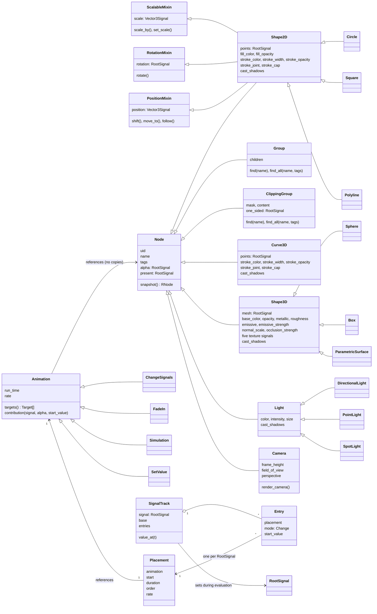
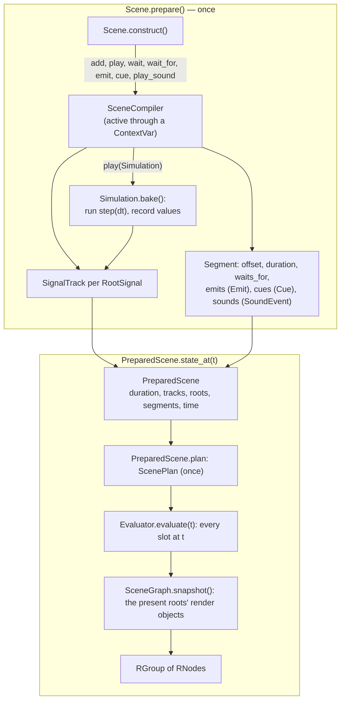
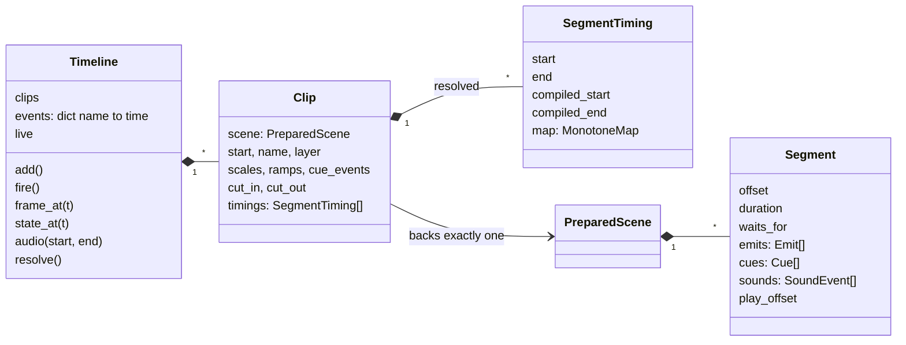
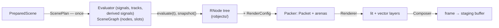
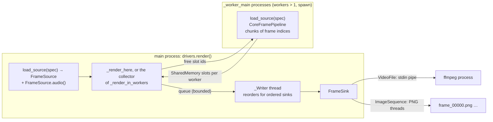
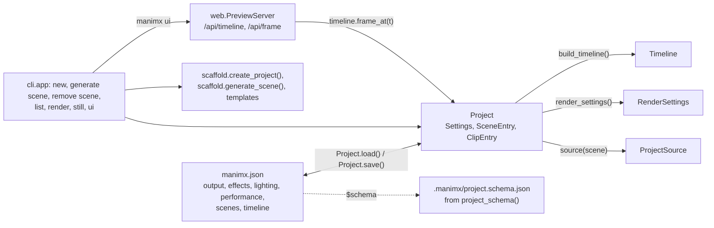

# manimx architecture

How manimx works as a whole: which classes exist, who creates and owns their
instances, how long they live, how data flows from `Scene.construct()` to
pixels and sound, and why it is built this way. Everything is named as in
the Python code. Where two classes share a name, the module comes first
(`animation.Group` is a `Node`). Render classes carry an R prefix
(`RGroup`, `RShape2D`, ...): an `RGroup` is the snapshot of an
`animation.Group`.

More detail: the native core (Rust) in [CORE.md](CORE.md) and
[core/README.md](core/README.md), the renderer's internals (passes,
shaders, buffers) in
[manimx/renderer/README.md](manimx/renderer/README.md), the animation
engine's design rationale in `docs/animation_engine_design.md` (repository
root), performance work in [PERFORMANCE.md](PERFORMANCE.md), usage in
[GETTING_STARTED.md](GETTING_STARTED.md).

Contents:

1. [The big picture](#1-the-big-picture)
2. [Packages](#2-packages)
3. [From `Scene.construct()` to a video](#3-from-sceneconstruct-to-a-video)
4. [The animation package](#4-the-animation-package)
5. [Timing: `Timeline`, `Clip`, `Segment`, `MonotoneMap`](#5-timing-timeline-clip-segment-monotonemap)
6. [Cameras and camera views](#6-cameras-and-camera-views)
7. [Render state: `RNode` trees](#7-render-state-rnode-trees)
8. [The renderer](#8-the-renderer)
9. [The core: `manimx._core`](#9-the-core-manimx_core)
10. [Drivers: `CoreFramePipeline`, processes, `FrameSink`, audio](#10-drivers-coreframepipeline-processes-framesink-audio)
11. [`Project` and the CLI](#11-project-and-the-cli)
12. [Lifetimes at a glance](#12-lifetimes-at-a-glance)
13. [Design decisions](#13-design-decisions)
14. [State of the work and next steps](#14-state-of-the-work-and-next-steps)

---

## 1. The big picture

manimx has two passes:

1. **Compile once.** `Scene.prepare()` runs `Scene.construct()` once and
   records what happens when:
   - every `Animation` gets a `Placement` and one `Entry` on the
     `SignalTrack` of each `RootSignal` it changes;
   - every `Simulation` is baked into recorded values;
   - every `Emit`, `Cue` and `SoundEvent` is stored in its `Segment`.

   The result is a `PreparedScene`.
2. **Evaluate anywhere.** A `ScenePlan` hands the prepared scene to the
   native core (`manimx._core`, Rust; section 9) as data once. For any
   time, in any order and in any process, the core sets every signal to
   its value and builds the render object tree of that time (section 7),
   without replaying anything and without per-object Python. Python
   runs per frame only where the user wrote per-frame Python (`derive()`
   functions, custom animations, unknown rate functions).
3. **Render.** A renderer is given the render object tree and a
   `RenderConfig`, nothing else. The core's renderer (`FrameRenderer`)
   packs, renders, composites and reads back; it never sees a signal.

Everything else follows from this split: random access makes scrubbing,
retiming, cutting and parallel rendering possible. The render object
tree is the one interface between the scene side and the render side,
so any renderer can draw a scene, and the core's renderer can draw any
tree, built by a scene or by hand. The core's `FrameRenderer` is
long-lived: it keeps GPU data per node uid and per value version across
frames and only writes what changed.

```mermaid
flowchart LR
    Code["Scene.construct()"] -->|"Scene.prepare() — once"| PS["PreparedScene<br/>SignalTrack, Segment"]
    PS --> TL["Timeline<br/>Clip, events"]
    Proj["manimx.json"] -->|"Project.build_timeline()"| TL
    TL -->|"frame_at(t) — any t, any order"| Plan["ScenePlan per clip<br/>(the core evaluates)"]
    Plan --> V["ViewStates<br/>RNode tree + camera"]
    V --> CP["CoreFramePipeline<br/>tree + RenderConfig"]
    CP --> Core["manimx._core.FrameRenderer<br/>Packer, Renderer, Composer"]
    Core --> D["drivers.render()<br/>worker processes"]
    D --> Out["VideoFile / ImageSequence"]
    TL -->|"Timeline.audio(start, end)"| D
```



## 2. Packages

| Package | Contents | Depends on |
|---|---|---|
| `manimx._core` | the native core (Rust, PyO3; `core/`): `Evaluator`, `FrameState`, `SceneGraph` (section 9), the render object classes (section 7), `FrameRenderer` | numpy; calls back into animation for user functions |
| `manimx.robjects` | the render object tree, implemented in the core: `RNode` and its subclasses `RGroup`, `RClippingGroup`, `RBezierPath` (→ `RShape2D`, `RCurve3D`), `RShape3D` (→ `RParticles`), `RLight` (→ `RDirectionalLight`, `RPointLight`, `RSpotLight`); `Fill`, `Stroke`, `MeshData`, `PbrMaterial`, `Texture`, `SurfaceShader`; `new_uid()`; in Python: `Transform`, `JointType`, `CapStyle` | `_core`, numpy |
| `manimx.animation` (core; `signals/` and `nodes/` hold the signal and node classes) | `RootSignal`, `DerivedSignal`, `Vector3Signal`, `TimeSignals`; `Node` and its subclasses (`Group`, `ClippingGroup`, `Shape2D`, `Curve3D`, `Shape3D` (→ `Particles`), `Light` → `DirectionalLight`, `PointLight`, `SpotLight`; `animation.Camera`), `PositionMixin`, `RotationMixin`, `ScalableMixin`; the `Animation` contract (`Animation`, `SetValue`, `ChangeSignals`/`AnimationBuilder`) and the default rates `linear`, `smooth`; `Scene`, `SceneCompiler`, `PreparedScene`; `Timeline`, `Clip`; `Simulation`; `Sound`; contributions as data (`signals/contributions.py`: `To`, `By`, `Ramp`, `Power`, `Turn`, `Keyframes`, `Between`, `Partial`), `paths.partial_path()`, `ScenePlan`, `scene_graph()`, `snapshot()` | robjects, `_core`; from `manimx.renderer` only the dataclasses `renderer.Camera` and `ViewState` |
| `manimx.userland` | everything a project could write on top of the core: shapes (`Circle`, `Dot`, `Square`, `Rectangle`, `RegularPolygon`, `Triangle`, `Polyline`, `ParametricCurve3D`, `Box`, `Sphere`, `Torus`, `ParametricSurface`), animations (`FadeIn`, `FadeOut`, `Rotate`, `Indicate`, `GrowFromCenter`, `ShrinkToCenter`, `Morph`, `Create`, `Uncreate`, `DrawBorderThenFill`, `Write`), `rate_functions`, `constants` (`UP`, `PI`, ...), `geometry` (every point and mesh generator, `align_paths()`), `load_gltf()` | animation, robjects |
| `manimx.renderer` | what a renderer is given next to the tree: `RenderConfig`, `renderer.Camera`, `ViewState`, `CameraViewState`; `MotionBlur`, `Bloom`, `ToneMap`, `ShaderEffect`; the WGSL shaders of the core's renderer | robjects |
| `manimx.drivers` | `render()`, `CoreFramePipeline`, `StillRenderer`, `render_image()`, `RenderSettings`, `FrameSource`, `load_source()`; `FrameSink` (→ `VideoFile`, `ImageSequence`, `FrameList`) | renderer, animation, `_core` |
| `manimx.project` | `Project`, `SceneEntry`, `ClipEntry`, `ProjectSource` | animation, drivers, settings |
| `manimx.settings` | `Settings` and its sections (`OutputSettings`, `EffectsSettings`, `LightingSettings`, `PerformanceSettings`), `setting()` | renderer (config, effects) |
| `manimx.cli` | the Typer `app` (`manimx` command), `scaffold`, `ui` | project, drivers, web |
| `manimx.web` | `PreviewServer` (standard library HTTP), `ProjectReloader` (reload on save) and the page (`static/`: HTML, CSS, plain JS modules) | animation, drivers, renderer, project |

`manimx.animation` never touches the GPU, and the renderer never sees a
`RootSignal`: a render object tree and a `RenderConfig` are all it gets.

## 3. From `Scene.construct()` to a video

```mermaid
sequenceDiagram
    autonumber
    participant CLI as cli.app.render
    participant P as Project
    participant S as Scene
    participant TL as Timeline
    participant D as drivers.render
    participant CP as CoreFramePipeline
    participant FR as _core.FrameRenderer
    participant W as _Writer thread
    participant FF as ffmpeg (VideoFile)

    CLI->>P: Project.find() reads manimx.json
    P->>S: import scenes.intro, Intro().prepare()
    S-->>P: PreparedScene
    P->>TL: Timeline.add() per ClipEntry, Clip.cut(), events
    CLI->>D: render(timeline, VideoFile, RenderSettings)
    D->>TL: Timeline.audio(first frame, last frame)
    D->>FF: VideoFile.open(FrameFormat with the audio)
    loop every time t of RenderSettings.frame_times()
        D->>CP: submit(index, t, timeline.frame_at)
        loop every time s of MotionBlur.sample_times(t)
            CP->>TL: frame_at(s): the core evaluates every signal and builds each clip's RNode tree
        end
        CP->>FR: render(index, sub-frames: per view the tree and its RenderConfig)
        FR->>FR: pack, render, composite every sub-frame and view; copy for read-back
        Note over FR: up to RenderSettings.in_flight frames on the GPU
        FR-->>CP: finished frames, in submission order
        CP-->>D: Future with the (H, W, 4) uint8 image
        D->>W: put(index, image)
        W->>FF: VideoFile.write in index order
    end
```

## 4. The animation package

### 4.1 Signals

Every animatable property of a `Node` is a signal:

- **`RootSignal`**: holds a value set from outside, by `authoring.change()`,
  by `SignalTrack.value_at()` during evaluation, or by a `Simulation` step.
- **`DerivedSignal`**: a pure function of other signals, created with
  `derive()` (and `PositionMixin.follow()`).
- **`SignalKind`** instances say how values interpolate and combine:
  `SCALAR`, `FACTOR`, `ROTATION` (slerp), `COLOR`, `PATH` (point arrays),
  `DISCRETE`.
- **`Vector3Signal`**: three `RootSignal`s `x`, `y`, `z`, so animations of
  different axes never interfere.
- **`TimeSignals`**: `scene_time` (stands still while a `Segment` waits) and
  `global_time` (always runs).

Setting a `RootSignal` invalidates its dependents; a `DerivedSignal`
recomputes when it is read. Every signal has a process-unique `id` and a
`version` that increases exactly when its value changes. The core keeps
the same versions per slot (section 9), and its caches key on them.

The classes live in `manimx/animation/signals/`: `signal.py` (the
signals), `kinds.py`, `signal_tracks.py` (section 4.2),
`contributions.py` (section 9), `rates.py` and `paths.py`. The node
classes live in `manimx/animation/nodes/`.

### 4.2 `Node`, `Animation`, `SignalTrack`



`Group`, `ClippingGroup`, `Camera` and the lights in this diagram are the
`manimx.animation` classes. `Circle`, `Square`, `Polyline`, `Sphere`, `Box`,
`ParametricSurface` and `FadeIn` are userland (`manimx.userland`), built on
the core classes they derive from. The mixins are left out of the diagram: every
`Node` subclass takes all three, except `Camera` (position and rotation),
`DirectionalLight` (rotation), `PointLight` (position) and `SpotLight`
(position and rotation).

- **The scene tree is parallel to the render tree.** Every `Node` class
  snapshots to exactly one R class (`Shape2D` → `RShape2D`, `Curve3D` →
  `RCurve3D`, `Shape3D` → `RShape3D`, `DirectionalLight` →
  `RDirectionalLight` and so on, `Group` → `RGroup`, `ClippingGroup` →
  `RClippingGroup`); `Camera` snapshots to nothing. Only `Group` and
  `ClippingGroup` have children, so `family()` only descends through
  them.
- **A node says once how it is drawn:** `Node.render_kind` names its R
  class (None: never drawn), `Node.render_fields()` yields which signal
  feeds which field (the mixins add the transform parts), and
  `Node.render_children()` its children. The core builds the render
  objects from that (section 9); `Node.snapshot()` asks it for the
  current values.
- **The transform comes in parts.** `PositionMixin`, `RotationMixin` and
  `ScalableMixin` each add one signal and the changes that use it, and a
  class takes the parts that mean something for it: `Group`,
  `ClippingGroup` and `Shape2D` take all three, `Camera` takes position and
  rotation. A missing part is the identity in the snapshot's `Transform`.
  Using a missing part raises an error that names the mixin, for example
  `Indicate(camera)` or `camera.scale_by(2)`.
- **Names and tags are for authoring only.** `Node.name` (meant to be
  unique, not checked) and `Node.tags` (a set of strings) work like an
  HTML id and classes: `group.find(name)` returns the one match below the
  group or raises a `LookupError` with close names, and
  `group.find_all(name=, tags=)` returns every match in tree order. Neither
  crosses to the render side; snapshots carry only the `uid`.

- **An `Animation` references its `Node`s** and never copies them.
  `Animation.targets()` names the `RootSignal`s it changes, each with a
  `Change` (`RELATIVE` or `ABSOLUTE`). `Animation.contribution()` is a pure
  function of the progress.
- **`Scene.play()`** creates one `Placement` per `Animation`, with its start,
  duration, authoring order and rate function.
- **Every `RootSignal` an `Animation` changes** gets a `SignalTrack` with
  one `Entry` per `Placement`. `SignalTrack.value_at(t)` folds the entries in
  authoring order: `RELATIVE` contributions combine, `ABSOLUTE` ones
  override, starting from `Entry.start_value`.
- **A direct call such as `square.shift(RIGHT)` inside `construct()`**
  becomes a `SetValue` placement at the current cursor
  (`authoring.change()`), so it does not rewrite the square's past.

### 4.3 `Scene.prepare()` and `PreparedScene.state_at()`



- **`state_at(t)` and `frame_at(t)` go through the core.** The plan
  (`PreparedScene.plan`, made on first use and again after `refresh()`)
  evaluates the tracks in Rust and builds the tree there; the Python
  signals are not touched.
- **`PreparedScene.evaluate(t)` sets the `RootSignal`s** in Python, for
  reading values (tests, tools, the authoring context); it is the
  reference the core is checked against (tests/test_plan.py). A
  `PreparedScene` still backs only one `Clip`.
- **Purity:** the result of `state_at(t)` depends only on `t`.
- **`Node.snapshot()`** builds the render objects of one node (and those
  below it) for the current signal values, in the core like every
  frame's (one R class per class, see section 4.2; `animation.Camera` →
  nothing). Each keeps the `Node.uid` (section 7).

### 4.4 `Simulation`

A `Simulation` wraps the user's `step(dt)` function, which changes
`Node`s however it likes. `SceneCompiler.play()` bakes it with
`Simulation.bake()`:

- `step` runs at the fixed step `dt` from start to end;
- before every step, each `RootSignal` with a `SignalTrack` from the same
  `play()` call (or earlier) is set to its value at that time;
- every `RootSignal` the step changes is recorded at `keyframe_rate`, in
  `Simulation.times` and the recorded values.

Afterwards the `Simulation` is an `ABSOLUTE` `Animation` that interpolates
the recorded values. `Simulation.emit()` and `Simulation.play_wave()` add an
`Emit` and a `SoundEvent` at the simulated time. There is no built-in physics
engine; this is deliberate.

### 4.5 `Sound`

A `Sound` holds float32 samples (`(count, 1)` or `(count, 2)`) and a
`sample_rate`. It comes from `Sound.load()` (WAV directly, anything else
through ffmpeg) or from an array. `Scene.play_sound()` and
`Scene.play_wave()` record a `SoundEvent` in the current `Segment` without
moving the cursor. `Timeline.audio()` (via `Clip.placed_sounds()` and
`mix()`) starts each `Sound` at the global time its point in the scene is
shown, then plays it at its own speed, so a `MonotoneMap` never changes its
pitch.

## 5. Timing: `Timeline`, `Clip`, `Segment`, `MonotoneMap`



- **`Segment`:** `Scene.wait_for(name)` closes a `Segment`. Segments lie on
  one compiled time axis, separated by `SEGMENT_GAP`, which is never shown.
  `Segment.play_offset` counts the time without those gaps.
- **Event names:** they get their times from `Timeline.events`
  (`Timeline.fire()`) or from an `Emit` in any `Clip`.
  `Timeline._resolve()` iterates to a fixed point: a `Segment` starts at the
  time of its `waits_for` event, or when the previous one ends if that is
  later. While editing, resolution is lenient. `Timeline.resolve()` is
  strict and raises `UnresolvedEvents` or `InvalidCue`. With
  `Timeline.live`, unfired events hold.
- **`MonotoneMap`:** each `SegmentTiming` maps global time to compiled time
  with a monotone cubic (PCHIP) through these knots:
  - the start;
  - every `Cue` whose event is known, so the cue lands exactly on it;
  - the edges of every `Ramp` (`Clip.slow_motion()`);
  - the end.
- **Layers:** clips that overlap in time are drawn over each other,
  lowest `Clip.layer` first, each through its own scene's camera, with
  its own depth, lights and shadows (`Timeline.frame_at()` returns one
  `ViewState` per active clip).
- **Lazy resolution:** `Clip.cut()`, `Clip.slow_motion()`,
  `Clip.bind_cue()` and `Clip.set_scale()` mark the `Timeline` dirty, and the
  next query resolves it once.

## 6. Cameras and camera views

- **`animation.Camera`:** every `Scene` has one (`Scene.camera`), a
  `Node` whose `RootSignal`s are `position`, `rotation`, `frame_height`,
  `field_of_view`, `perspective`, `focus_distance` and `aperture`; it is
  animated like any other `Node`. It is never drawn (no `render_kind`).
  `animation.Camera.render_camera()` returns a `renderer.Camera`, which
  `ViewState.camera` carries. A clip renders through its scene's camera,
  so retiming a clip retimes its camera moves too.
- **`CameraView(camera, width, height)`** (`animation/nodes/camera_view.py`): a
  `Shape2D` rectangle whose fill is the picture of another
  `animation.Camera`, tinted by the fill color. It moves, fades and is
  masked by a `ClippingGroup` like any `Shape2D`. Every `ViewState` lists
  its scene's present camera views in `ViewState.camera_views`
  (`CameraViewState`: uid, `renderer.Camera`, width, height), read from
  the plan's values like the scene camera; the renderer gets them in the
  view's `RenderConfig.camera_views`.
- **Rendering camera views:** before a view, the core's `FrameRenderer`
  renders each of its camera views at the frame's pixel size, with the
  view settings' aspect set to the plane's and the camera views' shapes
  hidden (`ViewSettings::picture`), so a picture never shows a
  camera view (no recursion; an explicit recursion depth is in
  FUTURE_IDEAS.md). Each picture is composited into one layer of the
  camera view texture (core/src/render/passes/camera_views.rs). The
  packer writes the layer and `1 / (width, height)` into the shape's
  `Object` record (`view`, `view_scale`); `vector.wgsl` samples the layer
  at the fill's local position.

## 7. Render state: `RNode` trees

The render object tree (`manimx.robjects`) is what a scene shows at one
time, one R class per node class (`RShape2D` is the snapshot of a
`Shape2D`), and the one interface between the scene side and the
render side: a renderer is given a tree and a `RenderConfig`, nothing
else. `PreparedScene.state_at(t)`, `Timeline.state_at(t)`,
`ViewState.root` and `Node.snapshot()` give trees; tests, tools (the web
UI's labels, `web/labels.py`) and renderers read them; a tree can be
built by hand as well.

The classes are implemented in the core (core/src/robjects/, exported by
core/src/python/robjects.rs), so the core builds a frame's tree without
a Python object per node and its renderer reads it without Python. In
Python they are constructed and read like dataclasses (`RShape2D(points=
..., fill=Fill("#58C4DD", opacity=0.5))`, `shape.fill.color`).

1. **`RNode.uid`:** every snapshot of one `Node` has the `Node.uid`.
   `new_uid()` counts up and never repeats within a process, so a new
   object is never mistaken for an old one (manimx never uses Python
   object addresses as identity).
2. **`RNode.alpha`:** every snapshot carries its `Node.alpha`; a reader
   multiplies the alphas down the tree, as the core's renderer does.
3. **`RNode.version(field)`:** the values that are costly to turn into
   GPU records (`points`, `fill`, `stroke`, `mesh`, `material`, the
   particles' arrays) carry a version. Equal versions promise equal
   values; the core reuses a value, version and all, while the signals
   it comes from do not change, so a renderer keeps what it built from
   it. A value made by hand gets a new version.
4. **Immutability:** render objects and their values never change once
   made. Reading a field makes a new Python object (a read-only numpy
   array, a `Fill`, a child), so render objects compare by `uid` and
   values by `version()`, never with `is`.
5. **Purity:** `state_at(t)` depends only on `t`.

The value types in `manimx.robjects` (`Transform`, `Fill`, `Stroke`,
`MeshData`, `PbrMaterial`, `Texture`, `SurfaceShader`) are also what
nodes take as arguments.

## 8. The renderer

The renderer is part of the core (`core/src/render/`), a library of its
own: it reads render object trees and the settings of a `RenderConfig`
(`ViewSettings`) and nothing else, no slots, no Python. How a frame is
drawn, pass by pass, with pictures, what it keeps between frames and why
it is built this way is in
[manimx/renderer/README.md](manimx/renderer/README.md). The Python
package `manimx.renderer` holds what a renderer is given next to the
tree: `RenderConfig`, `ViewState`, the effect settings, and the WGSL
shaders.

## 9. The core: `manimx._core`

A Rust extension module (`core/`, built with maturin; CORE.md has the plan
and the phases, core/README.md maps every module to the Python it ports).
It takes over the second and third passes, in three parts with the
render object tree between them:



- **`ScenePlan`** (animation/plan.py) puts every signal a prepared scene
  can read into slots and gives the core:
  - every `SignalTrack` with its entries. A contribution is data when the
    animation describes it (`Animation.planned_contribution()` returns a
    value of contributions.py), else the core calls `contribution()`
    back. Rates are data for `linear` and `smooth`, else called back;
  - every `DerivedSignal`: `follow()` offsets (`Offset`) are data, other
    functions are called back with the input values;
  - the `SceneGraph` (`scene_graph()`): every drawn node with its
    `render_kind`, uid, the slots of its `render_fields()` and its drawn
    `render_children()`. Nodes that are never drawn are left out.
- **`Evaluator.evaluate(t, scene_time, global_time)`** sets every slot like
  `PreparedScene.evaluate()` sets the signals; a slot's version increases
  exactly when its value changes. `Evaluator.state()` returns a
  `FrameState`: the values and versions at that time, shared, not copied.
- **`SceneGraph.snapshot(state, uid)`** builds the render object tree of
  a `FrameState` (core/src/evaluation/scene_graph.rs), with the rules of
  the scene side (absent roots and nodes scaled to nothing are left out,
  opacities and widths clamped). Every value is built once per version
  of the slots it comes from and shared by later trees, and a leaf whose
  slots kept their versions is the same render object: a tree costs
  about a walk over it. `ScenePlan.state_at(t)` and `frame_at(t)` return
  it as a Python `RGroup` without copying it.
- **`FrameRenderer`** (core/src/render/, its Python class in
  core/src/python/frame_renderer.rs) takes per view a tree and a
  `RenderConfig`. The `Packer` flattens the tree (world matrices, alphas,
  clip scopes, lights) and packs the records of a `Packet`: retained
  vector records (`vectors.rs`), meshes, materials and particles
  (`meshes.rs`), lights, shadow views, bounds and changed shadow layers.
  Records built from a value alone (triangulated fills, stroke curves,
  interleaved meshes, material entries, texture mips) are kept per node
  and value version. The renderer then draws on wgpu with the WGSL
  shaders, composites (bloom, shader effects, tone mapping, finalize)
  and reads back through a ring of staging buffers. `CoreFramePipeline`
  (drivers/core_pipeline.py) drives it. A frame whose views have the
  fingerprints of the frame before (every tree's uids, transforms,
  values and versions, and the settings) is held. One wgpu device per
  process.

**Equal results.** The evaluator computes in the same order as
`PreparedScene.evaluate()`; tests/test_plan.py compares every signal
(within 1e-12). Rendered frames are compared with reference images
(tests/test_rendering.py, tests/test_render_features.py), across the
example scenes, a scene with every node type, every built-in animation,
motion blur, bloom, shader effects, several views and every renderer
feature; a tree built by hand renders like the scene it copies.

**When it is used.** Always: `PreparedScene.frame_at()` and
`Timeline.frame_at()` evaluate through their plans, and
`drivers.render()`, its workers, `render_image()` and `manimx ui` render
with `CoreFramePipeline`.

## 10. Drivers: `CoreFramePipeline`, processes, `FrameSink`, audio



- **`CoreFramePipeline`:** keeps up to `in_flight` frames on the GPU,
  with one staging buffer per frame mapped while the next frames are
  prepared (section 9). `submit()` returns a
  `concurrent.futures.Future`, completed in submission order.
- **Worker processes:** each runs `_worker_main`, which rebuilds the source
  with `load_source()` from a `"module:Class"` string or a `ProjectSource`.
  Because `state_at` is pure, every process renders identical frames.
  Frames come back through `SharedMemory` slots owned per worker. A worker
  renders its frames in increasing order and waits only for its own slots,
  so in-order writing cannot deadlock.
- **`FrameSink`s:**
  - `VideoFile` runs ffmpeg and muxes the audio from `FrameFormat.audio`
    in the same pass;
  - `ImageSequence` writes PNG files plus `audio.wav`;
  - `FrameList` keeps the frames in memory.

  Sinks with `ordered = True` get frames in index order.
- **Audio:** `FrameSource.audio(start, end, sample_rate)` (from
  `Timeline.audio` or `PreparedScene.audio`) mixes exactly the rendered range
  before rendering starts. A silent mix means no audio track.

## 11. `Project` and the CLI



- **`Project` holds the state; `manimx.json` is its snapshot.** Code, the
  CLI and later the web UI change the same `Project` and call
  `Project.save()`. A `SceneEntry` references a `Scene` subclass by module
  and class.
- **`Project.load()` is strict.** It rejects unknown keys with a "did you
  mean" hint and checks types, limits, choices and colors. Older formats
  are migrated first (`_MIGRATIONS`).
- **Every setting is declared once**, with `setting()` in
  `manimx.settings`: default, description, limits, unit. The JSON schema
  (`project_schema()`), the `manimx settings` menu and its `--print`
  output, and the checks all read that declaration.
  `Settings.render_config()` and `Settings.effects_chain()` turn the
  settings into the `RenderConfig` and the composer's effects.
- **`Project.build_timeline()`** prepares every `ClipEntry`'s scene and
  calls `Timeline.add()`. A `ClipEntry` without `start` begins at the
  previous `Clip.end`.
- **`Project.scene_class()`** imports each scene module on its own, so a
  broken module only fails its own `SceneEntry`. A package of the same name
  from another project is evicted from `sys.modules` first.
- **`manimx ui`** builds the `Timeline` and serves it with
  `web.PreviewServer` (the first slice of the web UI: scrubbing only).
  The page asks for `GET /api/timeline` once (duration, frame rate, size,
  clips, segments) and then for one `GET /api/frame?t=&w=` at a time,
  remembering only the newest time it wants while a request is open, so
  the server never works through outdated times. With `--reload` (the
  default) `ProjectReloader` polls the modification times of
  `manimx.json` and the project's own `.py` files four times a second;
  after a change it loads the `Project` again, forgets its modules
  (`Project.unload_modules()`, which skips hidden folders and
  site-packages), builds the whole `Timeline` and calls
  `PreviewServer.replace()`. A failed build keeps the last timeline and
  calls `PreviewServer.report()`. Both bump `PreviewServer.version`; the
  page long-polls `GET /api/changes?since=`, fetches the timeline again
  and shows the time the user chose (clamped while it does not fit), or
  the error with the user's own frames only. The first build goes through
  the reloader too, so a broken scene does not stop `manimx ui`. Frames are rendered
  under one lock (its `StillRenderer` is not thread-safe) with the
  project's settings without motion blur, at the page's width, as JPEG.
  HTTP/1.1 keeps the connection open between frames. The time is part of
  the page's URL (`#t=`). A frame of the benchmark project takes 9.7 ms
  (2D) to 19.7 ms (3D) at 960 pixels, request included (measured with
  the Python renderer, before the core rendered).
- **`cli.ui`** prompts (questionary) only for missing arguments in a
  terminal. A `ProjectError` is printed as a panel with its `hint`. A
  `SceneError` comes with a rich traceback of the user's frames.

## 12. Lifetimes at a glance

| Instance | Created by | Owned by | Lives until | Changes? |
|---|---|---|---|---|
| `Node` and its signals | `Scene.construct()` | the `PreparedScene` (`roots`, `tracks`) | the `PreparedScene` | signal values on every evaluation |
| `MeshData`, `PbrMaterial`, `Texture` | user code, the mesh generators of `userland.geometry` (`box_mesh()`, `surface_mesh()`, ...), `load_gltf()` | shared: a `Shape3D`'s `mesh` signal and constant material, and the `RShape3D` snapshots | as long as anything references them | no (immutable) |
| `SceneCompiler` | `Scene.prepare()` | a ContextVar while `construct()` runs | the end of `prepare()` | yes |
| `PreparedScene` | `Scene.prepare()` (kept in `Scene._prepared`) | one `Clip` | the `Timeline` | only through evaluation |
| `SignalTrack`, `Placement`, `Entry` | `Scene.play()`, `authoring.change()` | the `PreparedScene` | the `PreparedScene` | `SignalTrack.refresh()` after edits |
| `Segment`, `Emit`, `Cue`, `SoundEvent` | `wait_for`, `emit`, `cue`, `play_sound`/`play_wave` | the `PreparedScene` | the `PreparedScene` | no (frozen) |
| `Timeline`, `Clip` | user code or `Project.build_timeline()` | the caller | the caller | yes; edits mark the `Timeline` dirty |
| `SegmentTiming`, `MonotoneMap` | `Timeline._resolve()` | the `Clip` | the next resolution | no |
| `RNode` tree | `SceneGraph.snapshot()` (`state_at()`, `frame_at()`, `Node.snapshot()`), or user code | whoever holds it; its values are shared with later trees | the last holder | no (immutable) |
| `Project` | `Project.load()` / `Project.find()` | the CLI command | the command | yes; `Project.save()` |
| `ScenePlan` (its `Evaluator` and `SceneGraph`) | `PreparedScene.plan`, on first use | the `PreparedScene` | the `PreparedScene`, or its next `refresh()` | slot values on every evaluation; the values the `SceneGraph` built |
| `FrameState` | `Evaluator.state()` | the `ScenePlan` while it builds a tree | that tree | no |
| `CoreFramePipeline` (its `FrameRenderer` with `Packer`, `Renderer`, `Composer`) | `drivers.render()`, `StillRenderer` | the render call, or the `StillRenderer` (one per configuration) | the call, or while among the last few configurations | its arenas, caches, GPU resources |
| the core's wgpu device (`Gpu::shared`) | the first `FrameRenderer` | the process | the process | |
| `_Writer` thread, `_worker_main` processes, ffmpeg | `drivers.render()` | the render call | the call | |

## 13. Design decisions

**Animation package**

- **Two passes: `Scene.prepare()` once, `state_at()` anywhere.** Random
  access is what makes scrubbing, retiming, cuts, previews, `MotionBlur` and
  worker processes simple. Replaying from the start on every query would
  rule them out.
- **A `RootSignal` per property and per axis (`Vector3Signal`).**
  Animations of different properties or axes compose without interfering.
  `DerivedSignal` replaces updaters with pure functions, which keeps
  evaluation deterministic.
- **An `Animation` references `Node`s; it never copies them.**
  `contribution()` is a pure function of progress, and `SignalTrack` holds
  the composition rules.
- **Direct changes inside `construct()` become `SetValue` at the cursor,
  and reads (`PositionMixin.get_center()`) see everything recorded so far.** Code
  reads like Manim but never rewrites the past.
- **Versions, not hashes.** A version counter costs nothing per frame. A
  revisited time costs one recomputation and is never wrong.

**Timing**

- **`wait_for`, `emit` and `cue` take names; times come from the
  `Timeline`.** A `Scene` stays reusable: `Timeline.fire()`, an `Emit` in
  another `Clip`, or (later) transcripts bind the times.
- **`MonotoneMap` with PCHIP.** It passes exactly through each `Cue`, never
  runs backwards, and changes speed smoothly.
- **A `Sound` is never retimed.** `Clip.slow_motion()` moves sound starts
  apart, but pitch stays.

**`Simulation`**

- **Baked in `Scene.prepare()`, not run during rendering.** `state_at`
  stays random access and parallel. The user writes `step(dt)`; there is no
  engine dependency. Animated `RootSignal`s are inputs; `DerivedSignal`,
  `Emit` and `SoundEvent` carry reactions.

**Identity**

- **Counted ids, never addresses.** Nodes, prepared scenes, clips,
  textures and surface shaders get an id from a counter when they are
  made, values a version; caches and keys use those. Python reuses the addresses of freed
  objects, so a key built from an address can match an object it was
  never made from.

**Renderer** (manimx/renderer/README.md has the details)

- **One renderer, in the core.** The Python renderer was the reference
  while the core was ported, and every change to rendering had to be
  written twice; the core's renderer is the only one now, checked
  against reference images (FUTURE_IDEAS.md, removed ideas).
- **The render object tree is the interface.** A renderer is given a
  tree and a `RenderConfig` and nothing else: it never reads signals,
  slots or timelines, and nothing calls back into Python while it packs.
  So any renderer can draw a scene, and the core's renderer any tree.
  An earlier version packed straight from the evaluator's slots; that
  coupled the renderer to the evaluator and was undone (CORE.md, "The
  interface, corrected").
- **Packing never touches the GPU, the renderer decides nothing about
  the scene.** The `Packer` turns a tree into records and keeps every
  per-node cache; the `Renderer` only uploads and draws.
- **Retained records:** vector records stay in arenas that mirror the
  GPU buffers, patched per frame; only changed ranges are uploaded. The
  cost follows what changed, not the size of the scene.
- **No meshes in a frame, no 3D passes.** Most Manim content is 2D.
- **`MotionBlur` renders real sub-frames.** Any change blurs correctly,
  including camera moves and appearing `Node`s.

**Drivers**

- **`CoreFramePipeline`, the `_Writer` thread and worker processes run
  together:** GPU, CPU, ffmpeg and disk all work at the same time.
- **Workers rebuild the source with `load_source()`.** Purity guarantees
  identical frames. Spawn instead of fork, because GPU devices do not
  survive a fork.

**`Project`**

- **`manimx.json` is a snapshot of `Project`.** Code, CLI and UI share one
  API, with no separate intermediate representation and no override files.
- **`Project.load()` is strict, with a schema from `project_schema()`.**
  Typos fail loudly, and editors check the file.

**The core**

- **The timeline as data, evaluated in Rust; user Python called back.**
  Per-object Python per sub-frame was the cost (light-show: 70 ms of CPU
  against 19 ms of GPU per frame). Python stays per frame only where the
  user wrote per-frame Python.
- **Python stays the reference for signal values.** The evaluator ports
  `PreparedScene.evaluate()` operation by operation; tests/test_plan.py
  compares every signal.
- **The render objects live in the core.** The tree is built per frame;
  as Python objects it was a large part of the CPU time (light-show:
  snapshots and flattening about a third). As Rust values the core
  builds it without Python, and Python reads it through the same
  classes it had before (`manimx.robjects`).
- **Morph replaces its source** (`ReplacementTransform`) instead of
  changing children: the scene structure stays fixed after `construct()`,
  which the core relies on.

**Performance policy**

- **Only measured improvements stay.** Every optimization is measured with
  `scripts/benchmark_project.py`, checked bit-identical with
  `--check-reference`, and recorded in PERFORMANCE.md, including what was
  dropped.

## 14. State of the work and next steps

**Done:**
- signals, `Node`, `Animation`, `Scene`; `Segment`, events, `Cue`,
  `MonotoneMap`; `Clip` layers; `Simulation`; `Sound`;
- `drivers.render()` with worker processes; `Project` and the CLI,
  `example-project/`, GETTING_STARTED.md;
- every render field has its signal on the scene class (checked by
  `tests/test_node_fields.py`): fills and strokes take one value or a
  list (gradients, tapering widths), joints and caps are `DISCRETE`,
  every `PbrMaterial` field of a `Shape3D` is a signal;
- 3D: `Curve3D`, `Shape3D`, `Particles`, the three lights with shadows
  (PCF, PCSS), `ClippingGroup` portals with scoped lights, surface
  shaders, camera views, depth of field, `load_gltf()`;
- the core (CORE.md): evaluation, render objects and rendering in Rust,
  with the render object tree as the interface; the only renderer;
- graphs with adaptive ticks, number lines, `BarChart`; `Table`,
  `Matrix` (`DecimalMatrix` of signals), `Integer`, `Variable`,
  `BulletedList`; Typst, SVG; `Code` with
  focus, regions, scrolling windows, `MorphCode`, `Flipboard`,
  `TypeCode`, `Untype` and `Blink`;
- `Morph`, `Create`, `Uncreate`, `DrawBorderThenFill`, `Write`, `Unwrite`;
- `manimx ui` with reload on save;
- performance (PERFORMANCE.md): the benchmark project from 48.6 fps to
  123.5 with the core; light-show 70 to 23 ms per frame.

Known gap: the deferred mesh pass ignores `PbrMaterial.opacity`, so
fading a `Shape3D` does not show yet (FUTURE_IDEAS.md: translucent
meshes).

**Next, in the agreed order:** porting Manim's remaining classes
(batches d, e, f), the rendering ideas, the web UI, then editing scenes
in the UI (keyframes, clips made in the UI, gizmos). FUTURE_IDEAS.md
keeps the ideas.

**Working conventions:**
- The scene tree (`Node` and its subclasses) and the render tree (`RNode`
  and its subclasses) are parallel: one R class per scene class, the R
  prefix on every render tree class, and every tree class in a module
  named after it on the scene side (`nodes/shape2d.py`); the render
  classes are in core/src/python/robjects.rs. Value types (`Transform`,
  `Fill`, `MeshData`, ...) carry no prefix.
- Core and userland: everything a project could have written itself on
  top of the public API is userland (`manimx.userland`: shapes, the
  built-in animations, rate functions, constants, geometry generators,
  the glTF loader); everything that would need a change of the animation
  system or the rendering logic is core (`manimx.animation`,
  `manimx.robjects`, `manimx.renderer`). The core never imports
  userland. `manimx` itself exports the authoring API: core scene
  classes, userland and the value types nodes take; render classes stay
  in `manimx.robjects`.
- Everything that generates geometry (points of paths, meshes of solids)
  lives in `userland.geometry`; the render side has no constructors that
  generate shapes or aim lights. Examples and scenes use the shape classes
  (`Circle`, `Square`, `Polyline`, `Box`, `Sphere`, ...) and the node
  methods (`move_to`, `rotate`, `set_scale`), never render objects.
- Render objects carry no names: names belong to nodes. Identity across
  snapshots is the `uid`, which tests allocate with `new_uid()` too.
- Commits are kernel style, with the design decisions in the message. Commit only `manimx/`; `docs/`, the root
  `pyproject.toml` and the root `uv.lock` belong to the user.
- Tests: `uv run --active pytest` in `manimx/`, with coverage at least 90%.
- The core: `maturin develop --release` in `manimx/` (with the
  environment manimx is installed in active) after every change to
  `core/` (`uv run` rebuilds it when the sources change); `cargo clippy`
  in `core/` stays clean. Rust code is written to be read by someone who
  has never seen it: one folder per stage of a frame, one concept per
  module, a module doc saying what it does, names from the Python code.
- Every algorithm from elsewhere is cited next to its code with a link,
  and listed in REFERENCES.md.
- Identity is a counted id, never a Python object address.
- Benchmark: check the power mode, run `scripts/benchmark_project.py
  tests/projects/benchmark --check-reference <ref.npz>`, report.
- Don't run `ruff check` without `--no-fix`: the project config fixes files
  in place.
- Describe everything with its name from the Python code.
