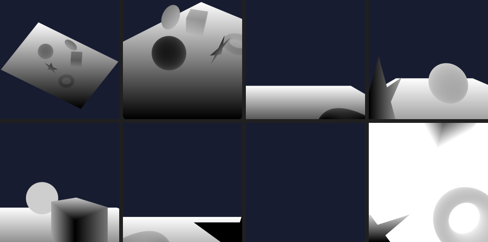
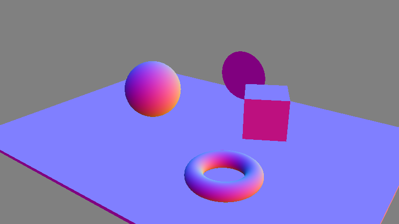
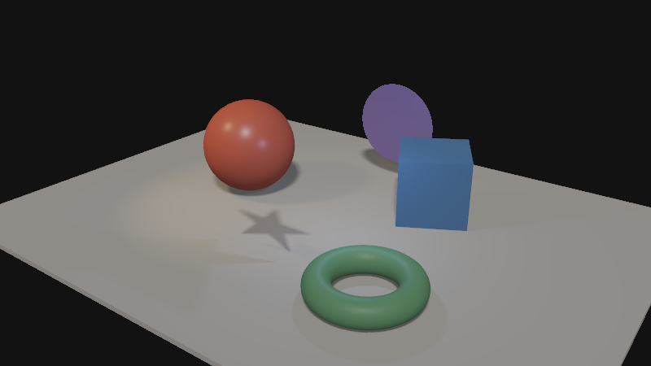
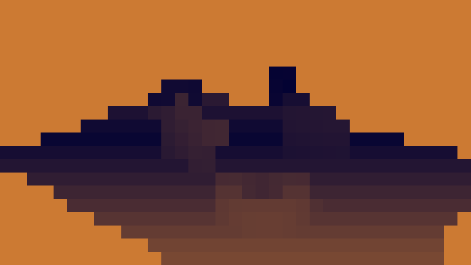
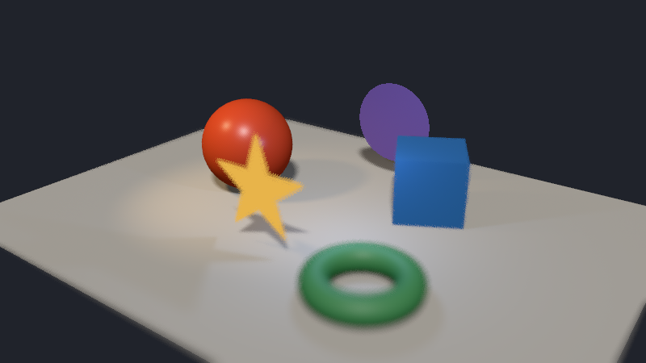
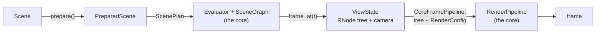
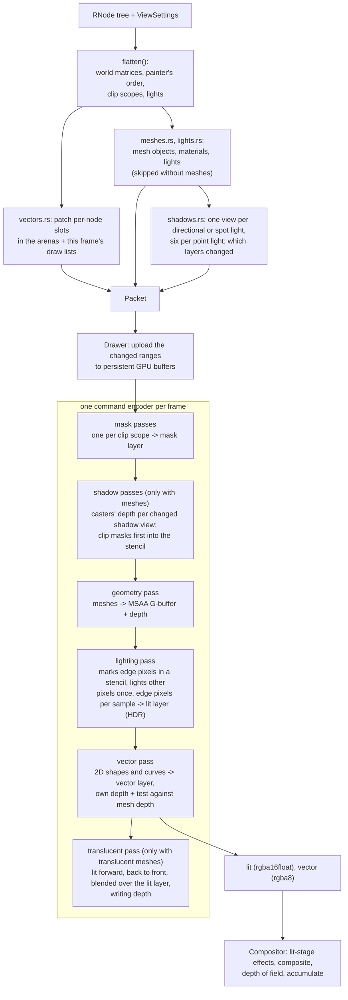
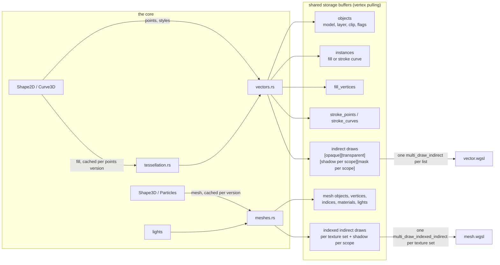
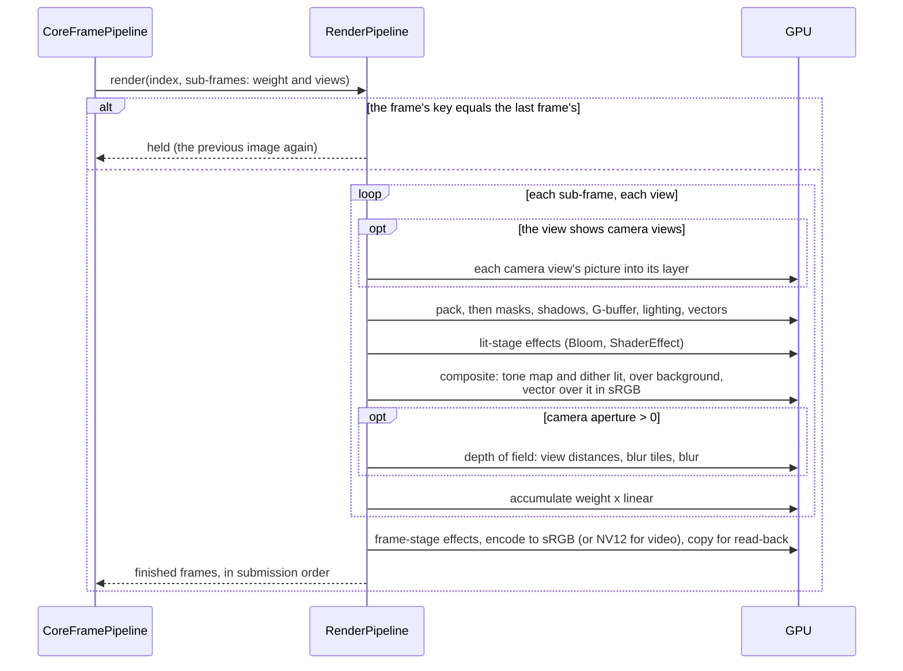
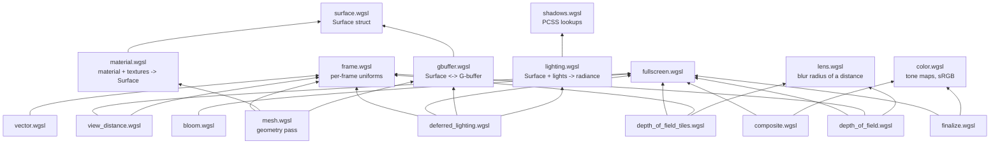

# manimx-core

The native core of manimx, imported in Python as `manimx._core`. Why it
exists and where it is going: [../CORE.md](../CORE.md).

## Build and test

```sh
# from manimx/, with the environment manimx is installed in active
maturin develop --release        # builds and installs manimx._core
pytest tests/test_plan.py        # the core against the Python reference
cargo clippy --release           # in core/
```

Python must be rebuilt into the environment after every change to the
Rust sources; `import manimx._core` otherwise still loads the old module.

## Modules

Three parts, one folder each, and one interface between them: the render
object tree (`robjects/`). The renderer is given a tree and its settings
and nothing else; it never sees signals, slots or timelines. Every
folder's `mod.rs` says in a few lines what it holds.

```text
src/
  lib.rs           the Python module manimx._core
  evaluation/      signals at a time, and the render object tree of them
  robjects/        the render object tree: the interface
  render/          a tree and its settings drawn into a frame
    pipeline.rs    RenderPipeline: runs the stages
    pack/          Pack: the tree as GPU records (shapes/: fills, strokes)
    draw/          Draw: geometry/ (what is drawn), passes/ (in order)
    composite/     Composite: effects, compositing, accumulating
    output/        Output: RGBA or NV12, read back
    gpu/           device, shaders, buffers, fullscreen passes, timing
  python/          the Python classes of robjects/ and render/
shaders/           the WGSL shaders, compiled into the library
```

```text
evaluation/   signals at a time ──snapshot──▶  robjects/  ◀──reads──  render/
```

| Module | What it is | Python counterpart |
|---|---|---|
| `lib.rs` | the Python module `manimx._core` | |
| `evaluation/evaluator.rs` | `Evaluator`: all signals of a scene in slots, set to their values at a time; `FrameState` | `PreparedScene.evaluate()`, `ScenePlan` (animation/plan.py) |
| `evaluation/scene_graph.rs` | `SceneGraph`: the scene's nodes and the slots of their fields; the render object tree of a `FrameState` | `Node.render_kind`, `Node.render_fields()`, `Node.snapshot()` |
| `evaluation/track.rs` | one signal's track and its entries, folded at a time | `SignalTrack`, `Entry`, `Placement` (animation/signals/signal_tracks.py) |
| `evaluation/contribution.rs` | what one animation does to one signal at a progress | `Animation.contribution()`, animation/signals/contributions.py |
| `evaluation/rates.rs` | rate functions | animation/signals/rates.py |
| `evaluation/value.rs` | signal values and the operations of their kinds | animation/signals/kinds.py |
| `evaluation/paths.rs` | the part of a path drawn so far | animation/signals/paths.py |
| `robjects/mod.rs` | `RNode` and its kinds, `Transform`, uids and versions | `manimx.robjects` |
| `robjects/values.rs` | points, `Fill`, `Stroke`, `Mesh`, `Material`, `Texture`, `SurfaceShader`, particles | `Fill`, `Stroke`, `MeshData`, `PbrMaterial`, ... |
| `python/robjects.rs` | the Python classes of the render objects | `manimx.robjects` |
| `python/render_pipeline.rs` | `RenderPipeline`, the Python class of the renderer; reads a `RenderConfig` | drivers/core_pipeline.py drives it |
| `render/pipeline.rs` | `RenderPipeline`: sub-frames and views through the stages, held frames, stage timing | |
| `render/settings.rs` | `ViewSettings`: camera, camera views, lighting and shadow settings | `RenderConfig`, `Camera` (renderer/config.py) |
| `render/pack/packer.rs` | `Packer`: one view's tree in, a `Packet` of draws and changed records out | |
| `render/pack/flatten.rs` | the tree's drawable leaves with world matrices, clip scopes and lights | |
| `render/pack/vectors.rs` | retained records of `RShape2D` and `RCurve3D` | |
| `render/pack/meshes.rs` | records of `RShape3D` and `RParticles` | |
| `render/pack/lights.rs`, `shadows.rs` | light records and the default light; shadow views, scene bounds, which shadow layers changed | |
| `render/pack/arena.rs`, `records.rs` | growable record arrays mirroring GPU buffers; the GPU record structs (bytemuck), as the WGSL structs declare them | shaders/ |
| `render/pack/shapes/` | fills as triangles (lyon, nonzero rule), strokes as linked curve records | |
| `render/draw/mod.rs` | `Drawer`: prepares the geometry, runs the passes of one view | |
| `render/draw/geometry/` | `VectorGeometry`, `MeshGeometry`: buffers, pipelines, draws per role; images, camera views, material textures | |
| `render/draw/passes/` | `mask`, `shadow`, `gbuffer`, `lighting`, `vector`, `translucent` | |
| `render/draw/targets.rs` | every texture a view is drawn into | |
| `render/composite/` | `Compositor`: lit-stage effects, compositing, depth of field, accumulating, frame-stage effects; `effects/` | renderer/effects.py (settings) |
| `render/output/` | `Output`, `PixelFormat`: the frame as RGBA or NV12, staging buffers, read-back | drivers/sinks.py (`PixelFormat`) |
| `render/gpu/` | the device, the shader table, growing buffers, fullscreen passes, GPU and CPU timing, reading textures back | |

Math is [glam](https://docs.rs/glam) (`DMat4`, `DQuat`, `DVec3` in f64,
converted to f32 only when a record is written); records are `#[repr(C)]`
structs written with [bytemuck](https://docs.rs/bytemuck).

## The renderer

The renderer draws render object trees into frames, and nothing else:
it reads a tree and the settings of a `RenderConfig` (Python's, read
field by field into `ViewSettings` by python/render_pipeline.rs), no
signals, slots or Python. Its usage, what it draws and its known
limitations are in [../manimx/renderer/README.md](../manimx/renderer/README.md).

### A pipeline of stages

A frame passes through named stages, each with one input and one output
and the state it keeps between frames. Evaluating the scene comes
before them and is not part of the renderer (`evaluation/`, and Python
for user code): the renderer starts at a finished render object tree.

```text
drivers.render():  Evaluate ─▶ [ RenderPipeline: Pack ─▶ Draw ─▶ Composite ─▶ Output ]
                   evaluation/   render/ (no Python, no signals)
```

| Stage | Struct | In | Out | Keeps between frames |
|---|---|---|---|---|
| Evaluate | `Evaluator`, `SceneGraph` (evaluation/) | a time | per sub-frame its weight and views (`SubFrame`, `View`), each a tree and its `ViewSettings` | the slots |
| Pack | `Packer` (pack/) | a view's tree | `Packet`: draw lists; the arenas hold the records and which ranges changed | path and mesh caches, the arenas the GPU buffers mirror |
| Draw | `Drawer` (draw/) | `Packet` | `RenderTargets`: the lit (HDR) and vector layers, depths | GPU buffers, pipelines, render targets |
| Composite | `Compositor` (composite/) | the layers of every view and sub-frame | the accumulated frame after its effects | effect textures |
| Output | `Output` (output/) | the frame | RGBA or NV12 bytes, in submission order | staging buffers |

`RenderPipeline` (pipeline.rs) owns the stages and runs them:
`render(index, sub_frames)` packs, draws and composites every view of
every sub-frame and hands the frame to Output; `finished()` returns the
frames read back so far. The Python class (`_core.RenderPipeline`) is a
thin wrapper over it, driven by `CoreFramePipeline`
(manimx/drivers/core_pipeline.py). A struct is named for what its stage
does, and its folder for the stage; nothing is called just "renderer".

**Queues.** Today the stages run one after the other on the caller's
thread, while up to `in_flight` frames are on the GPU. The stages could
also run with queues between them (Pack on its own thread a few frames
ahead, since a `Packet` and the changed arena ranges are uploaded in
order; read-back on another). The stage timings (`stage_timings()`,
PERFORMANCE.md) show no need yet: without motion blur the video encoder
is the limit, with it the evaluation and `submit`.

**Inside Draw: geometry and passes.** Geometry (draw/geometry/) is what
is drawn: `VectorGeometry` (`RShape2D`, `RCurve3D`) and `MeshGeometry`
(`RShape3D`, `RParticles`), each with its buffers, pipelines and bind
groups and a draw per role (color, mask, shadow, G-buffer, translucent).
Passes (draw/passes/) are the steps, in order: mask, shadow, gbuffer,
lighting, vector, translucent; a pass chooses its target and which
geometry it draws in which role. The shape math (fills, strokes) is CPU
work and lives in pack/shapes/.

**Output.** Output finishes the frame for where it goes: RGBA (sRGB
values, straight alpha) or NV12 for video encoders, converted on the GPU
(finalize.wgsl), copied into a staging buffer and read back while the
next frames are drawn. In the browser, a WebCodecs `VideoFrame` made
from the frame's texture would be another kind of output, without
read-back.

**Shaders.** The WGSL shaders live in shaders/ and are compiled into
the library (render/gpu/shaders.rs); `#include "file.wgsl"` lines are
expanded from that table, so the renderer reads no files at run time.

### A frame, step by step

One scene from [scripts/render_internals.py](../scripts/render_internals.py),
which renders these pictures by reading the renderer's textures back: a
floor, three meshes, a 2D star standing up, a box seen through a round
clip mask, a sun, a warm spot light and a blue point light.


**1. Shadow maps.** Every light that casts shadows renders the casters'
depth as seen from it (black is near). A directional light and a spot
light have one map each, a point light six, the faces of a cube around
it; an empty face stays empty. The 2D star casts its exact outline. The
box behind the round mask casts only what the mask lets through (the
ellipse in the sun's map, top left): the mask is drawn into the map's
stencil first, and the box only where the stencil allows.



**2. Clip masks.** Every clip scope draws its mask into a layer of a
texture array; content inside the scope is multiplied by it.


**3. G-buffer.** The geometry pass draws the meshes once and stores what
lighting needs per MSAA sample: base color, normal (shown as color),
roughness and metallic, emission, the clip scope, and depth. No light is
computed yet.

| base color | normal |
|---|---|
|  |  |

**4. Lighting.** A fullscreen pass lights the G-buffer with every light,
looking shadows up in the maps. Most pixels hold one surface in all
their samples and are lit once; only the pixels where samples differ,
marked magenta here, are lit per sample, which keeps their edges
antialiased.

| pixels lit per sample | four times enlarged |
|---|---|
|  |  |

**5. Two layers.** Lit meshes end up in a linear HDR layer; 2D shapes
and curves in a separate layer of exact sRGB colors (here only the star,
over a checkerboard). The star is in the lit layer only as its shadow.

| lit layer | vector layer |
|---|---|
|  |  |

**6. Composite.** The lit layer is tone mapped and dithered, put over the
background, and the vector layer over it in sRGB values: the frame at
the top.

**7. Depth of field.** With the camera's `aperture` open, three more
passes blur the composited view: the distance of every pixel from the
camera (black is near), the largest blur radius per tile (dark: sharp,
orange: the largest blur), and the blur, which gathers each pixel from
as far as the tiles around it say blur reaches. Here the focus is on the
red ball.

| view distances | blur per tile |
|---|---|
|  |  |



### How it is built

#### From a scene to a frame



- **`ScenePlan`** (manimx/animation/plan.py) gives every signal of a
  prepared scene a slot in the core's `Evaluator` and describes the
  nodes as a `SceneGraph` (which node reads which slot). `frame_at(t)`
  sets every slot to its value at `t` and returns a `ViewState` whose
  root is the render object tree of that time, built in Rust: values
  whose slots did not change are the same values, with the same
  versions.
- **`CoreFramePipeline`** (manimx/drivers/core_pipeline.py) asks for the
  views of each sub-frame (one, or the motion blur samples) and hands the
  `RenderPipeline` each view's tree with its `RenderConfig` (the view's
  camera and camera views, the time).
- **`RenderPipeline`** does the rest in Rust, reading only the tree and
  the config (see the stages above).

#### One view



#### Data flow into the GPU



Every 2D shape or curve of a frame shares the same buffers. A draw's
`first_instance` selects its records, so the whole opaque vector list is
a single `multi_draw_indirect` call, and so is the transparent list.
Strokes are expanded on the GPU: one instance per cubic curve, with ribbon,
joint and cap triangles generated in the vertex shader.

#### The compositor



#### Shader modules

WGSL has no module system. The core expands `#include "file.wgsl"` lines
(each file at most once per shader, core/src/render/gpu/device.rs).



Depth of field runs three of them per view: `view_distance.wgsl`
resolves each pixel's distance from the MSAA depth buffers once,
`depth_of_field_tiles.wgsl` finds the largest blur in every tile (a tile
is as large as the largest blur), and `depth_of_field.wgsl` gathers each
pixel's blur from as far as the tiles around it say anything blurred
reaches.

#### What is kept between frames

A `RenderPipeline` lives as long as its `CoreFramePipeline`, and keeps:

| What | Kept by | Key | Dropped |
|---|---|---|---|
| a path's fill triangles, stroke links, colors | `PathCache` (pack/vectors.rs) | node uid + versions of the values they come from | when the node is not drawn for 1024 packs |
| a mesh's interleaved vertices, a material's entry | `MeshPacker` (pack/meshes.rs) | node uid + mesh or material versions | when the node is not drawn for 1024 packs |
| vector records on the GPU | the arenas of `VectorPacker` (pack/vectors.rs, pack/arena.rs) | (node uid, drawn as a mask) | when the node leaves the scene; everything packed again when garbage outweighs live records |
| mesh vertices and indices on the GPU | the arenas of `MeshPacker` | node uid + mesh version | when the mesh is not placed in a frame with meshes; packed again when garbage outweighs live data |
| shadow map layers | `ShadowLayers` (pack/shadows.rs) decides, the shadow pass keeps the depth | the layer's Frame record and its scope's casters (fingerprint, world matrix) | rendered again when the key changes or the maps are made again |
| textures and their mip levels | `MeshGeometry` (draw/geometry/textures.rs) | texture uid and color space | when no frame uses them |
| render targets | `RenderTargets` (draw/targets.rs) | size, MSAA, mask layers | on a size change |
| the last frame | `RenderPipeline` | every view's tree fingerprint (uids, transforms, plain values, versions) and settings without the time | when a frame with another key is rendered |

Every render object has its node's uid and every costly value a version
that is new exactly when the value is (`RNode.version()`,
core/src/robjects/), so the caches never need to be told what changed.
Moving a node (its world matrix) never invalidates its records; it only
patches its object entry. Changing its points does.

### Design decisions

**Triangulated fills by the nonzero rule, not stencil-then-cover.** Fills
are triangulated on the CPU by lyon's fill tessellator with the nonzero
winding rule, Cairo's: any path fills like Cairo draws it, also one whose
subpaths cross (a morph's in-between shapes), and a path that changes a
little fills a little differently, never flipping. Curves are flattened
within 1e-4 of the path's size. Triangles batch into shared buffers, are
cached per object version, and are real geometry for shadows and later ray
tracing. An earlier fill kept curves exact (earcut plus Loop-Blinn curve
triangles) but assumed subpaths that never cross: mid-morph, holes filled
and emptied from one frame to the next. Measured on 1,000,000 mid-morph
glyphs, lyon takes 27 µs per path on one core (earcut with exact curves
15 µs); only paths whose points changed are triangulated again.
Stencil-then-cover would keep curves exact at any zoom, by the same rule,
but needs two passes per object and batches poorly.

**Strokes expanded on the GPU.** One instance per cubic curve, sampled in
24 segments, with miter, bevel and round joints and butt, square and round
caps. Widths are in world units (Manim's width 4 is 0.04 units) and ignore
the object's scale, like Manim. `Shape2D` ribbons lie in the shape's plane;
`Curve3D` ribbons face the camera. Both are the same code with a different
"ribbon normal".

**Painter's order with real depth.** Instead of drawing strictly in tree
order (which splits batches whenever the pipeline changes), each 2D shape
gets a layer from its tree order, and the fragment shader pulls it towards
the camera by `layer * (step + fwidth(depth) / 64)`. The slope term keeps
coplanar layers apart on steeply tilted planes. Opaque shapes then need no
sorting; transparent ones are sorted back to front.

**The layer bias never applies against meshes.** Vector shapes have their
own depth buffer for the layer bias, and are hidden behind meshes by an
explicit, unbiased per-sample test against the mesh depth. Before this was
separated, a late shape with a large layer could be pulled through a mesh
surface it was behind.

**Deferred shading with an MSAA G-buffer.** Lighting runs in fullscreen
passes, so overdraw does not multiply lighting cost, and lighting and
screen-space effects are separate passes. The G-buffer is multisampled to
keep the crisp MSAA edges that vector graphics need, at about 100 MB at
1080p. Inside a surface the geometry pass writes the same values to all
samples of a pixel, so the lighting pass first marks the pixels whose
samples differ (depth, normal, colors or clip scope, with small
tolerances) in a stencil, lights the others once where their first sample
lies, and only the marked ones per sample. Material evaluation and
lighting live in separate shader modules, so moving lighting between
passes does not touch materials.

**Translucent meshes are shaded forward.** A G-buffer holds one surface
per sample, so meshes whose opacity or alpha is below 1 are left out of
it. After the vector pass they are drawn sorted back to front by the
view depth of their centers, lit in the fragment shader with the same
material, surface shader and lighting code, and blended over the lit
layer (premultiplied), depth-tested against the opaque meshes. Each is
drawn twice, back faces then front faces, so the far side of a closed
mesh is behind its near side. A clip mask fades them softly instead of
cutting at half coverage.

They write depth. Sorting by centers goes wrong for meshes of very
different sizes: a large floor's center can be nearer than a block
standing on it, so the floor is drawn last. Without depth it would be
blended over the block; with depth it is hidden where the block is, and
the block shows the floor's lit layer behind it instead of the floor
(at the start of a fade, exactly the opaque picture). The vector pass
runs before, so 2D shapes still test against the opaque meshes only.

**Translucent shadows tint the light.** Translucent casters write no
shadow depth. A second pass per shadow layer draws them, depth-tested
against the opaque casters, into two more layers: the light they let
through (1 - alpha, multiplied, so two surfaces of a closed mesh both
count) and the distance of the nearest one along the light's view. A
receiver behind that distance gets the light times the transmittance,
filtered over 2x2 texels, so the shadow is as light as the caster is
clear, without the grain of a dithered depth map.

**2D colors stay exact.** Lit meshes render to a linear HDR layer and 2D
content to a separate sRGB layer. The compositor tone-maps only the lit
layer, then blends the vector layer over it in sRGB values, which is how
Manim blends. A `#FC6255` square comes out as `#FC6255` under any tone
mapping operator. Only the tone-mapped lit layer is dithered (half a
level of noise), which breaks the bands of smooth 3D gradients in 8 bits
without touching 2D colors.

**Transparent shapes sort by view depth.** Transparent draws are sorted
back to front by the depth of their center along the view direction,
not by the distance to the camera, which ordered shapes on a common
plane wrongly away from the screen's center.

**Alpha masks, not stencil clipping.** A `ClippingGroup` multiplies its
content by the mask's rendered alpha, so masks can be soft or gradients.
Each scope's mask is a texture layer; nested masks are clipped by their
parent, so one lookup covers all enclosing groups. Clipped content goes
into the transparent list and keeps correct depth.

**Images are fills.** `Shape2D.fill_image` (and `Image`, a rectangle
with one) shows a texture in a 2D fill, so images fade, clip and keep
the painter's order like any shape, and their colors stay exact (2D is
never tone mapped). The frame's images share one 2D array texture with
mip levels (draw/geometry/images.rs), stored as premultiplied sRGB values; each
sits in the top left of its layer with its edge repeated into the
padding, and a small region buffer maps the shape's local box onto it.
`Object.view` tells image layers (below `NO_VIEW`) from camera view
layers. The array is made again only when the frame's list of images
changes; its layers are as large as the largest image (at most 4096
pixels), so one large image makes every layer large.

**Lights scoped to clipping groups.** A light inside a `ClippingGroup` only
lights, and only gets shadows from, objects in that group. The G-buffer
stores each pixel's scope, and shadow casters and bounds are built per
scope. This is what lets each portal world have its own lighting.

**Shadows from the existing pipelines.** Shadow maps are rendered by
the normal mesh and vector pipelines with a light as "camera", so 2D
shapes cast exact curved shadows and curves face the light. A point
light has six maps, the faces of a cube.

- **Taps in the receiver's plane.** Every soft-shadow tap is a point on
  a disk in the surface's plane, lifted off it by 1.5 texels, projected
  into whichever map (cube face) it falls in and compared with its own
  depth. So a surface never shadows itself at any angle to the light,
  and soft edges continue across the faces of a point light.
- **PCF or PCSS.** PCF averages the taps over a fixed radius. PCSS first
  searches for blockers and widens the radius by the light's size and
  the blocker's distance (similar triangles), so shadows are sharp at
  contact and softer with distance.
- **Shared taps across a frame's renders.** With `RenderSamples` each
  render takes a share of the taps (`shadow_samples / shadow_share`,
  at least 4) with its pattern turned differently, and the frame's
  average gets them all. The pattern is also turned per pixel and MSAA
  sample by white noise, which averages away instead of leaving a
  pattern.
- **Clipped casters cast clipped shadows.** Before the casters inside a
  clip scope are drawn into a map, the masks between the light and them
  are drawn into the map's stencil (depth32float-stencil8), and the
  casters only where the stencil says all masks cover. A light inside a
  clip scope is behind that scope's masks, so those do not apply.

**Depth of field by gathering.** The blur of a pixel is a thin lens's
circle of confusion. Each pixel gathers taps on a turned golden-angle
spiral, and a tap counts where its own blur reaches the pixel ("scatter
as gather"); a tap behind the pixel counts only as far as the pixel's
own blur, so sharp things never get a blurred background over them,
while blurred things in front spread over sharp things behind.

**Motion blur by sub-frames.** The renderer is stateless and frames can be
rendered in any order, so it cannot remember the previous frame for motion
vectors. The pipeline renders the scene at several times inside the
shutter and averages them in linear light. That is exact for any change,
including morphing points, at the cost of one render per sample.

**Stateless renderer, versioned values.** The renderer receives the
whole scene every frame: a render object tree and a `RenderConfig`.
Per-node data is cached by node uid and value versions and dropped when
a node is not drawn for a while, so caching never needs the renderer to
track the scene.

### Former names

| Before | Now |
|---|---|
| `FrameRenderer` (render/frame_renderer.rs) | `RenderPipeline` (render/pipeline.rs) |
| render/packing/, render/geometry/ | render/pack/, render/pack/shapes/ |
| `Renderer` (render/renderer.rs), render/passes/ | `Drawer` (render/draw/), its geometry/ and passes/ |
| `Composer` (render/composer.rs), render/effects/ | `Compositor` (render/composite/) |
| read-back in `FrameRenderer` | `Output` (render/output/) |
| `RendererOptions` | `PipelineOptions` |
| manimx/renderer/shaders/, manimx/renderer/images/ | core/shaders/, core/images/ |

## Rules

* The renderer reads render object trees and `ViewSettings`, nothing
  else (no `evaluation`, no `pyo3`): any tree, built by the core or by
  hand in Python, is drawn the same way. The renderer is checked against
  reference images (tests/references/).
* Where Python computes the same thing (signal values), the Python code
  is the reference. Ported functions compute in the same order, so both
  agree to the last bits where possible; tests/test_plan.py compares
  them.
* Whatever the core does not know (a custom `SignalKind`, a rate function,
  an animation without a data form, a `derive()` function) stays a Python
  object and is called back.
