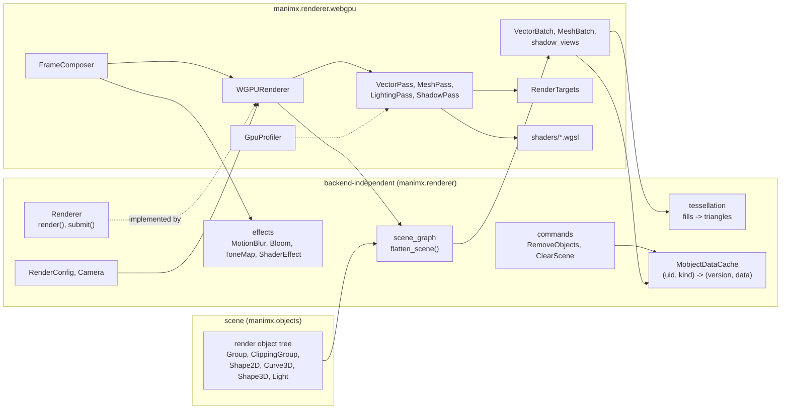
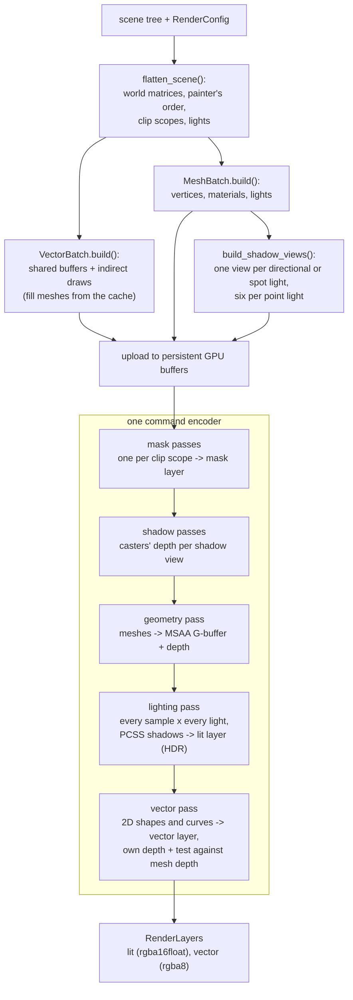
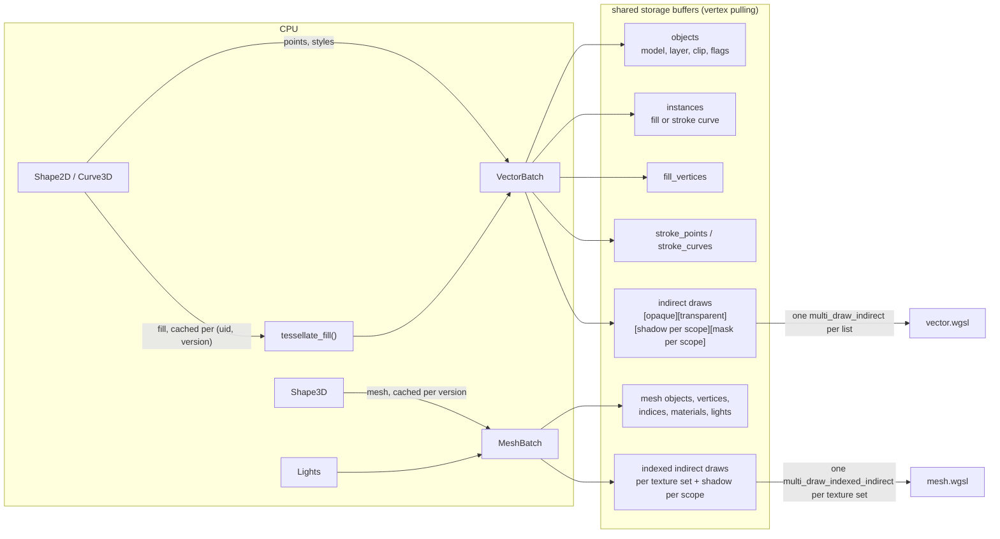
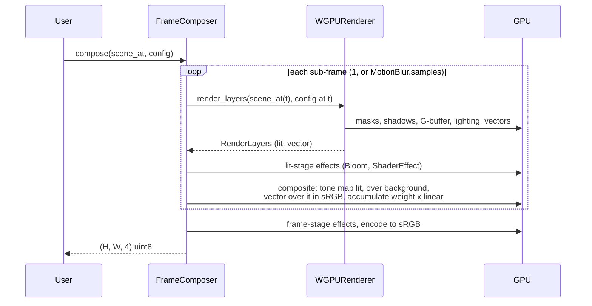
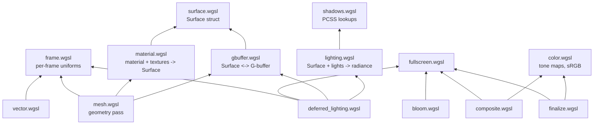
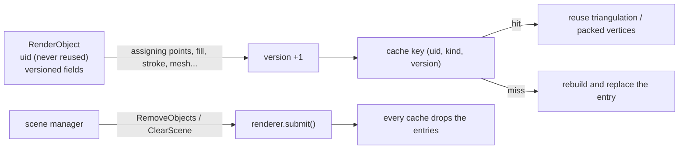

# manimx.renderer

A WebGPU renderer for manimx scenes, written in Python and WGSL on top of
[wgpu-py](https://github.com/pygfx/wgpu-py). It takes a tree of render
objects plus a `RenderConfig` and produces an image. It keeps no scene
state of its own, so frames can be rendered in any order and in parallel
processes.

What it draws:

- **Shape2D**: Manim's vector shapes (VMobject layout). Exact curved fills,
  strokes with per-point color, opacity and width, all joint and cap
  styles, painter's order.
- **Curve3D**: stroke-only Bezier curves in 3D, always facing the camera,
  thinner with distance.
- **Shape3D**: lit triangle meshes with glTF metallic-roughness materials
  and textures. glTF/GLB files are imported with `manimx.io.load_gltf`.
- **Lights**: directional, point and spot, with soft contact-hardening
  shadows.
- **ClippingGroup**: soft alpha masks, optionally one-sided (portals), with
  lights scoped to the group.
- **Effects**: motion blur, bloom, tone mapping and custom WGSL shaders,
  chained by a `FrameComposer`.

---

## Usage

### Render a scene

```python
from PIL import Image

from manimx import Fill, Group, Stroke, Transform
from manimx.objects.geometry import circle, square
from manimx.renderer import RenderConfig, WGPURenderer

scene = Group("scene", children=[
    square("square", fill=Fill("#525893", opacity=1.0), stroke=Stroke("#525893")),
    circle("circle", fill=Fill("#87c2a5", opacity=1.0), transform=Transform(position=(1.5, 0.0, 0.0))),
])

renderer = WGPURenderer()  # create once and reuse: it caches GPU resources
image = renderer.render(scene, RenderConfig(pixel_width=1920, pixel_height=1080, background_color="#ece6e2"))
Image.fromarray(image).save("frame.png")  # (H, W, 4) uint8 RGBA, straight alpha
```

`RenderConfig` holds everything that is not part of the scene: size,
background, camera, MSAA, time, lighting and shadow settings.

```python
import math
from manimx.renderer import Camera, RenderConfig

config = RenderConfig(
    pixel_width=1280, pixel_height=720,
    camera=Camera.look_at((9, -12, 7), (0, 0, 1), field_of_view=math.radians(45)),  # perspective
    msaa_samples=4,
    shadows=True, shadow_resolution=2048, shadow_softness=1.0, shadow_samples=16,
    ambient_intensity=0.15, exposure=1.0,
)
```

Without `field_of_view` the camera is orthographic and shows
`frame_height` world units vertically (8, like Manim). World `+z` is up in
3D scenes, as in Blender and Manim's 3D scenes.

### 3D: meshes, lights, glTF

```python
from manimx import DirectionalLight, PbrMaterial, PointLight, Shape3D, SpotLight, Transform, sphere_mesh
from manimx.io import load_gltf

ball = Shape3D("ball", mesh=sphere_mesh(1.0), material=PbrMaterial("#FC6255", roughness=0.3),
               transform=Transform(position=(0, 0, 1)))
helmet = load_gltf("DamagedHelmet.glb")  # a Group; converted from glTF's Y-up to Z-up
sun = DirectionalLight.aimed("sun", (-1, 1, -2), intensity=3.0, size=0.03)  # size: softness
lamp = PointLight("lamp", color="#58C4DD", intensity=15, transform=Transform(position=(-2, -2, 2)))
spot = SpotLight.aimed("spot", (0, -4, 6), (0, 0, 0), outer_cone_angle=0.4)
```

Only `Shape3D` meshes are lit. 2D shapes and curves keep their exact Manim
colors, but they still cast shadows onto meshes. Shadows can be turned off
globally (`RenderConfig.shadows`), per light (`cast_shadows`) and per
object (`cast_shadows` on any shape). If a scene has no lights at all, a
default key light is used.

### Clipping and portals

```python
from manimx import ClippingGroup

portal = ClippingGroup("portal", mask=square_face, content=world, one_sided=True)
```

The content is shown multiplied by the mask's alpha. The mask counts its
fill and stroke as they would be drawn, so a 40% opaque mask lets 40%
through. `one_sided=True` opens the mask only where it faces the camera.
Lights inside `content` only light that content. See
`manimx/examples/portal_cube.py` for four worlds inside one cube.

### Effects: the frame composer

```python
from manimx.renderer import Bloom, FrameComposer, MotionBlur, ShaderEffect, ToneMap, ToneMapOperator

composer = FrameComposer(renderer, [
    MotionBlur(samples=16, shutter=1 / 120),
    Bloom(threshold=1.0, intensity=0.1),
    ToneMap(ToneMapOperator.ACES),
])
image = composer.compose(lambda t: scene_at(t), RenderConfig(time=2.0))
```

The composer sits in front of the renderer. `MotionBlur` asks the renderer
for one frame per sub-frame time inside the shutter and averages them.
Without it, or when the scene is a fixed object instead of a function of
time, the renderer is called once.

`ShaderEffect` runs your own WGSL on the lit 3D layer (`stage="lit"`,
linear HDR) or on the final frame (`stage="frame"`):

```python
vignette = ShaderEffect("""
    fn effect(uv: vec2<f32>, pixel: vec2<i32>) -> vec4<f32> {
        let color = textureLoad(source, pixel, 0);
        return vec4<f32>(color.rgb * (1.0 - value(0u) * dot(uv - 0.5, uv - 0.5)), color.a);
    }
""", values=(1.5,))
```

### Objects leaving the scene

The renderer caches derived data per object (fill triangulations, packed
vertices). When objects are deleted, tell it with a command:

```python
from manimx.renderer import ClearScene, RemoveObjects

renderer.submit(RemoveObjects.subtree(old_group))
renderer.submit(ClearScene())
```

### Profiling

```python
renderer = WGPURenderer(profile=True)
renderer.render(scene, config)
print(renderer.profiler.read())  # {"shadows": 0.4, "geometry": 0.2, "lighting": 0.6, ...} ms on the GPU
```

---

## Architecture

### Components



The `Renderer` interface (`base.py`) is all a backend has to implement. The
scene graph, tessellation, cache, commands, config and effect settings are
backend independent, so a path tracer or a Blender bridge could reuse them.

### One frame



`render_layers()` stops at the layers. `render()` adds a default composer
(tone mapping only) and a read-back.

### Data flow into the GPU



Every 2D shape or curve of a frame shares the same buffers. A draw's
`first_instance` selects its records, so the whole opaque vector list is
a single `multi_draw_indirect` call, and so is the transparent list.
Strokes are expanded on the GPU: one instance per cubic curve, with ribbon,
joint and cap triangles generated in the vertex shader.

### The frame composer



### Shader modules

WGSL has no module system. `GPUContext.shader()` expands
`#include "file.wgsl"` lines (each file at most once per shader).



### Caching and object lifecycle



Fields declared with `versioned()` count their assignments. Moving an
object (its `transform`) never invalidates its triangulation; replacing
its `points` does. Versioned arrays are read-only, so mutating them in
place is an error rather than a stale cache.

### Module map

| Module | Role |
|---|---|
| `base.py` | `Renderer` interface |
| `config.py` | `RenderConfig`, `Camera` |
| `scene_graph.py` | `flatten_scene`: transforms, painter's order, clip scopes, lights |
| `tessellation.py` | fill triangulation with exact curves |
| `cache.py`, `commands.py` | per-object data cache and lifecycle commands |
| `effects.py` | effect settings for the composer |
| `webgpu/renderer.py` | `WGPURenderer`: builds batches, encodes the passes |
| `webgpu/composer.py` | `FrameComposer`: sub-frames, effects, compositing |
| `webgpu/vector_batch.py`, `vector_pass.py` | 2D shapes and curves |
| `webgpu/mesh_batch.py`, `mesh_pass.py` | meshes, materials, lights (geometry pass) |
| `webgpu/lighting_pass.py` | deferred lighting |
| `webgpu/shadow_views.py`, `shadow_pass.py` | shadow map views and rendering |
| `webgpu/targets.py` | all render targets of a frame, `RenderLayers` |
| `webgpu/frame.py` | the per-frame uniform block |
| `webgpu/gpu.py` | device, formats, growable buffers, WGSL includes |
| `webgpu/profiler.py` | GPU timestamp queries per pass |

---

## Design decisions

**Triangulated fills with exact curves, not stencil-then-cover.** Fills are
triangulated on the CPU (earcut) with one extra Loop-Blinn triangle per
quadratic, whose fragment test keeps curved edges exact at any zoom. Cubics
are split into quadratics with a bounded error. Triangles batch into shared
buffers, are cached per object version, and are real geometry for shadows
and later ray tracing. Stencil-then-cover would handle self-intersecting
paths exactly and needs no CPU work when points change every frame, but it
needs two passes per object and batches poorly.

**Strokes expanded on the GPU.** One instance per cubic curve, sampled in
24 segments, with miter, bevel and round joints and butt, square and round
caps. Widths are in world units (Manim's width 4 is 0.04 units) and ignore
the object's scale, like Manim. Shape2D ribbons lie in the shape's plane;
Curve3D ribbons face the camera. Both are the same code with a different
"ribbon normal".

**Painter's order with real depth.** Instead of drawing strictly in tree
order (which splits batches whenever the pipeline changes), each 2D shape
gets a layer from its tree order, and the fragment shader pulls it towards
the camera by `layer * (step + fwidth(depth) / 64)`. The slope term keeps
coplanar layers apart on steeply tilted planes. Opaque shapes then need no
sorting; transparent ones are sorted back to front.

**The layer bias never applies against meshes.** Vector shapes have their
own depth buffer for the layer bias, and are hidden behind meshes by an
explicit, unbiased per-sample test against the mesh depth. Before this was
separated, a late shape with a large layer could be pulled through a mesh
surface it was behind.

**Deferred shading with an MSAA G-buffer.** Lighting runs once per sample
in a fullscreen pass, so overdraw does not multiply lighting cost, and
lighting and screen-space effects are separate passes. The G-buffer is
multisampled to keep the crisp MSAA edges that vector graphics need, at
about 100 MB at 1080p. Material evaluation and lighting live in separate
shader modules, so moving lighting between passes does not touch materials.

**2D colors stay exact.** Lit meshes render to a linear HDR layer and 2D
content to a separate sRGB layer. The composer tone-maps only the lit
layer, then blends the vector layer over it in sRGB values, which is how
Manim blends. A `#FC6255` square comes out as `#FC6255` under any tone
mapping operator.

**Alpha masks, not stencil clipping.** A ClippingGroup multiplies its
content by the mask's rendered alpha, so masks can be soft or gradients.
Each scope's mask is a texture layer; nested masks are clipped by their
parent, so one lookup covers all enclosing groups. Clipped content goes
into the transparent list and keeps correct depth.

**Lights scoped to clipping groups.** A light inside a ClippingGroup only
lights, and only gets shadows from, objects in that group. The G-buffer
stores each pixel's scope, and shadow casters and bounds are built per
scope. This is what lets each portal world have its own lighting.

**PCSS shadows from the existing pipelines.** Shadow maps are rendered by
the normal mesh and vector pipelines with a light as "camera", so 2D
shapes cast exact curved shadows and curves face the light. Softness comes
from the light's physical size (blocker search, then a penumbra from
similar triangles), sharp at contact and softer with distance.

**Motion blur by sub-frames.** The renderer is stateless and frames can be
rendered in any order, so it cannot remember the previous frame for motion
vectors. The composer renders the scene at several times inside the
shutter and averages them in linear light. That is exact for any change,
including morphing points, at the cost of one render per sample.

**Stateless renderer, versioned objects.** The renderer receives the whole
tree every frame. Per-object data is cached by runtime-unique uid and per
field versions, and invalidated by assignment or by lifecycle commands, so
caching never needs the renderer to track the scene.

---

## Known limitations

- **CPU batch building dominates large scenes.** 10 000 circles at 1080p
  take about 1.2 s per frame, against 26 ms of GPU time. Persistent GPU
  buffers with incremental updates would remove most of this.
- **Motion blur cost scales with samples:** 16 samples are 16 full renders.
- **The lighting pass shades every MSAA sample.** With several
  shadow-casting lights, PCSS costs lights x samples x taps per pixel.
- **Directional shadows use one map** fitted to the scope's bounds; very
  large scenes need cascades. Shadow maps ignore clip masks.
- **Self-intersecting fills** are triangulated as simple polygons, like
  ManimGL.
- **Painter's order between non-coplanar 2D planes:** where two 2D planes
  intersect, their layer bias can flip single pixels along the
  intersection.
- **Meshes are opaque** (no glTF alpha modes), clip at 50% mask coverage,
  and cannot be masks themselves.
- **glTF import** skips animations, skins, morph targets, cameras, lights,
  sparse accessors, vertex colors, a second UV set, samplers and
  extensions.
- **No image-based lighting:** metals reflect only a uniform ambient term.
- **Requires** the `indirect-first-instance` feature and wgpu-native's
  `multi_draw_indirect`; `timestamp-query` is optional (profiler).

---

## Tests and benchmarks

```bash
uv run pytest                                      # all tests, including the renderer's
uv run pytest manimx/renderer/tests                # only the renderer
uv run pytest -m visual --update-references        # regenerate reference images (review them!)
uv run pytest manimx/renderer/benchmarks --no-cov  # benchmarks with GPU time per pass
```

- `tests/test_render_pipeline.py`: scene graph, cache, commands,
  tessellation, batch layout, cameras (no GPU needed)
- `tests/test_webgpu_renderer.py`, `test_composer.py`, `test_shadows.py`,
  `test_portals.py`: behavior checked through rendered pixels
- `tests/test_portal_cube.py`: why the portal cube is correct, by
  rendering it twice with one change (isolation, corners, light leakage,
  depth regression)
- `tests/test_visual.py`: reference images in `tests/references/`. On a
  mismatch, `*.actual.png` and `*.diff.png` are written next to the
  reference.

GPU tests are skipped when no adapter is available.
