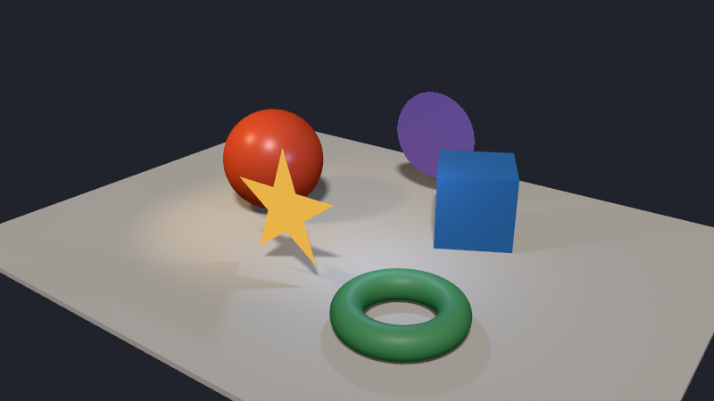
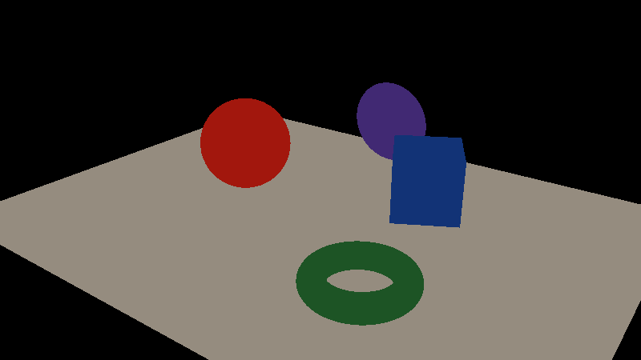
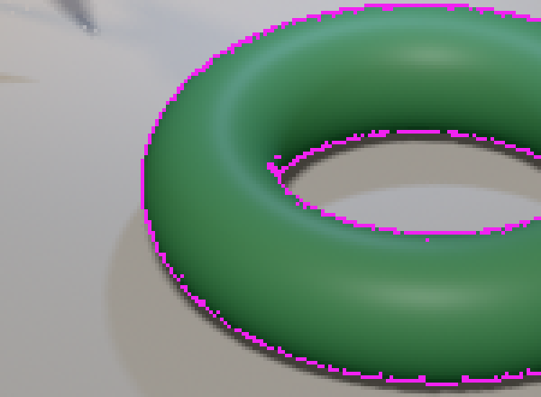
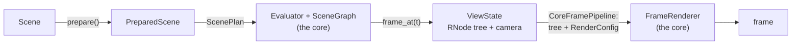
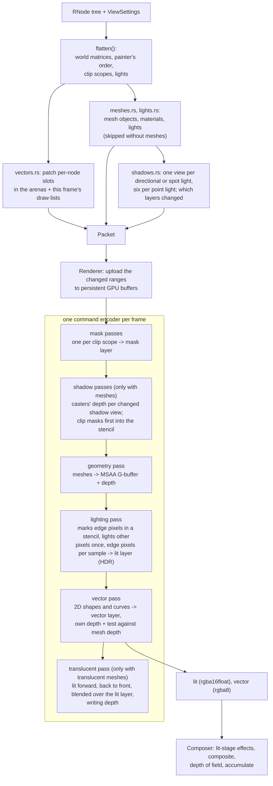
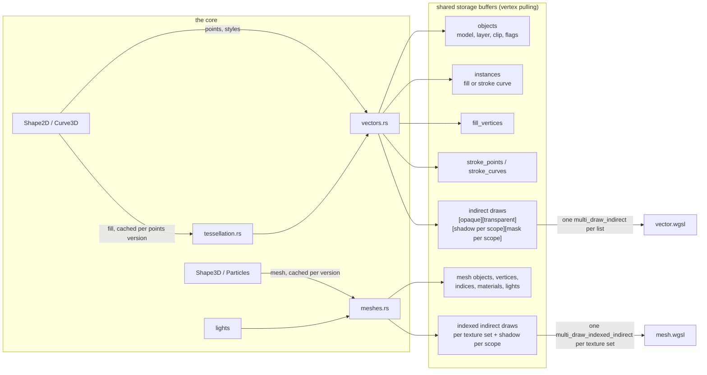
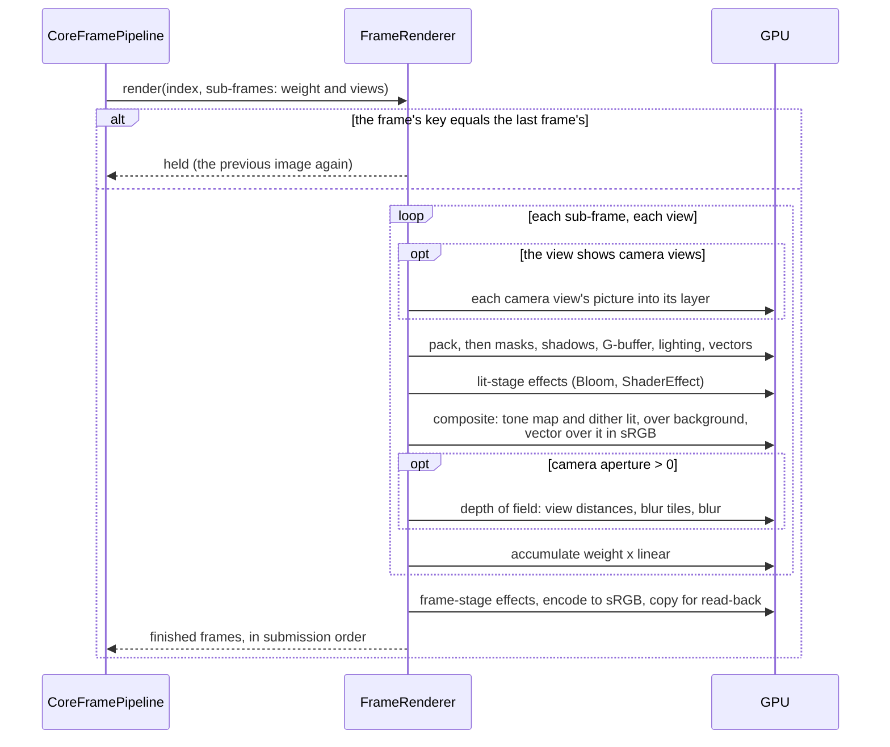
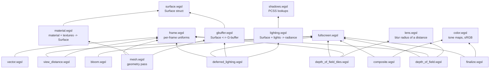

# manimx.renderer

How manimx turns a scene at one time into an image. A renderer is given
a render object tree (`manimx.robjects`: `RGroup`, `RShape2D`, ...) and a
`RenderConfig`, nothing else. The renderer itself is Rust on
[wgpu](https://wgpu.rs), in the core
([core/src/render/](../../core/src/render/mod.rs), `manimx._core.FrameRenderer`);
this package holds what it is given next to the tree:

- `RenderConfig` and `Camera` (config.py): size, background, camera,
  MSAA, lighting and shadow settings; `ViewState`, a tree with the
  camera looking at it;
- the effect settings (effects.py): motion blur, bloom, tone mapping,
  custom WGSL;
- the WGSL shaders (shaders/), which the core loads from here.

`CoreFramePipeline` (manimx/drivers/core_pipeline.py) drives the
renderer; `manimx render`, `manimx still`, the render workers, the web UI
and `render_image` all go through it. The renderer keeps no scene state
of its own beyond caches, so frames can be rendered in any order and in
parallel processes.

What it draws (each render object is the snapshot of the scene node of
the same name without the R):

- **`RShape2D`**: vector shapes. Exact curved fills, strokes with
  per-point color, opacity and width, all joint and cap styles, painter's
  order.
- **`RCurve3D`**: stroke-only Bezier curves in 3D, always facing the
  camera, thinner with distance.
- **`RShape3D`** and **`RParticles`**: lit triangle meshes with glTF
  metallic-roughness materials, textures and custom surface shaders.
  glTF/GLB files are imported with `manimx.userland.load_gltf`, which
  builds scene nodes.
- **Lights**: directional, point and spot, with shadows: PCF (a fixed
  narrow soft edge) or PCSS (soft edges that widen with the distance to
  the caster).
- **`RClippingGroup`**: soft alpha masks, optionally one-sided (portals),
  with lights scoped to the group; casters inside one cast only the
  shadow of what their masks let through.
- **Camera views**: another camera's picture on an `RShape2D` (the snapshot of a `CameraView`).
- **Effects**: motion blur, depth of field (a camera's `aperture`),
  bloom, tone mapping and custom WGSL shaders.

---

## Usage

### Render a still

```python
from PIL import Image

from manimx.drivers import render_image
from manimx.renderer import RenderConfig
from manimx.userland import Circle, Square

shapes = [
    Square(2.0, color="#525893", fill_opacity=1.0),
    Circle(1.0, color="#87c2a5", fill_opacity=1.0).move_to((1.5, 0.0, 0.0)),
]
config = RenderConfig(pixel_width=1920, pixel_height=1080, background_color="#ece6e2")
image = render_image(shapes, config=config)  # (H, W, 4) uint8 RGBA, straight alpha
Image.fromarray(image).save("frame.png")

image = render_image(MyScene, time=2.5, config=config)  # a scene at a time
```

`render_image` takes a `Scene` class or instance, a prepared scene, a
timeline, or nodes (seen through `config.camera`). It keeps one
`CoreFramePipeline` per configuration (`StillRenderer`,
manimx/drivers/stills.py), so frames of the same size reuse its GPU
resources. Videos are rendered with `manimx render` (manimx/drivers/offline.py),
which keeps several frames on the GPU at once.

`RenderConfig` holds everything that is not part of the scene: size,
background, camera, MSAA, time, lighting and shadow settings.

```python
import math
from manimx.renderer import Camera, RenderConfig

config = RenderConfig(
    pixel_width=1280, pixel_height=720,
    camera=Camera.look_at((9, -12, 7), (0, 0, 1), field_of_view=math.radians(45)),  # perspective
    msaa_samples=4,
    shadows=True, shadow_resolution=2048, shadow_samples=16, shadow_method="pcf",
    ambient_intensity=0.15, exposure=1.0,
)
```

Without `field_of_view` the camera is orthographic and shows
`frame_height` world units vertically (8, like Manim). World `+z` is up in
3D scenes, as in Blender and Manim's 3D scenes. A scene renders through
its own camera (`Scene.camera`); `config.camera` is for nodes rendered
on their own.

### 3D: meshes, lights, glTF

```python
from manimx.animation import DirectionalLight, PointLight, SpotLight
from manimx.userland import Sphere
from manimx.robjects import PbrMaterial

ball = Sphere(1.0, name="ball", material=PbrMaterial("#FC6255", roughness=0.3)).move_to((0, 0, 1))
sun = DirectionalLight(direction=(-1, 1, -2), intensity=3.0, size=0.03)  # size: softness
lamp = PointLight(position=(-2, -2, 2), color="#58C4DD", intensity=15)
spot = SpotLight(position=(0, -4, 6), target=(0, 0, 0), outer_cone_angle=0.4)
```

Only meshes are lit. 2D shapes and curves keep their exact Manim colors,
but they still cast shadows onto meshes. Shadows can be turned off
globally (`RenderConfig.shadows`), per light (`cast_shadows`) and per
node (`cast_shadows` on any shape). If a scene has no lights at all, a
default key light is used.

`shadow_method` picks the filter: `"pcf"` (projects and previews by
default) blurs every shadow edge by a fixed 1.5 texels; `"pcss"` makes
edges sharp where an object touches the surface and softer with distance,
by the light's `size` (Randima Fernando's
[percentage-closer soft shadows](https://developer.download.nvidia.com/shaderlibrary/docs/shadow_PCSS.pdf)).

### Clipping and portals

```python
from manimx.animation import ClippingGroup

portal = ClippingGroup(square_face, world, one_sided=True)  # mask, content
```

The content is shown multiplied by the mask's alpha. The mask counts its
fill and stroke as they would be drawn, so a 40% opaque mask lets 40%
through. `one_sided=True` opens the mask only where it faces the camera.
Lights inside the content only light that content. See
`manimx/examples/portal_cube.py` for four worlds inside one cube.

### Effects

```python
from manimx.renderer import Bloom, RenderSamples, ShaderEffect, ToneMap, ToneMapOperator

effects = [
    RenderSamples(count=16, shutter=1 / 120),
    Bloom(threshold=1.0, intensity=0.1),
    ToneMap(ToneMapOperator.ACES),
]
image = render_image(MyScene, time=2.0, config=config, effects=effects)
```

`RenderSamples` averages `count` renders of a frame. Each moves the
camera by a fraction of a pixel (the Halton sequence in bases 2 and 3:
the projection is shifted in normalized device coordinates, so meshes,
2D shapes and their shadows all move together) and turns the shadow
taps, so edges and soft shadows come out smooth even from few taps per
render. With a `shutter` above 0 the renders are spread over it, and
moving things blur. Every render is a full render, so the cost of a
frame grows with `count`; projects render once per frame unless asked
(`output.samples`, with `effects.motion_blur` to spread them).

Depth of field is not an effect in the list but the camera's lens: with a
`Camera.aperture` above 0, its view is blurred by each pixel's distance from
`focus_distance` (a thin lens, see shaders/depth_of_field.wgsl).

`ShaderEffect` runs your own WGSL on the lit 3D layer (`stage="lit"`,
linear HDR) or on the final frame (`stage="frame"`):

```python
vignette = ShaderEffect("""
    fn effect(uv: vec2<f32>, pixel: vec2<i32>) -> vec4<f32> {
        let color = textureLoad(source, pixel, 0);
        return vec4<f32>(color.rgb * (1.0 - value(0u) * dot(uv - 0.5, uv - 0.5)), color.a);
    }
""", values=(1.5,))
```

### Profiling

```python
from manimx.drivers import CoreFramePipeline

pipeline = CoreFramePipeline((), config, profile=True)
pipeline.render(MyScene().prepare().frame_at, 1.0)
print(pipeline.gpu_timings())  # {"shadows": 0.4, "geometry": 0.2, "lighting": 0.6, ...} ms on the GPU
```

---

## A frame, step by step

One scene from [scripts/render_internals.py](../../scripts/render_internals.py),
which renders these pictures by reading the renderer's textures back: a
floor, three meshes, a 2D star standing up, a box seen through a round
clip mask, a sun, a warm spot light and a blue point light.



**1. Shadow maps.** Every light that casts shadows renders the casters'
depth as seen from it (black is near). A directional light and a spot
light have one map each, a point light six, the faces of a cube around
it; an empty face stays empty. The 2D star casts its exact outline. The
box behind the round mask casts only what the mask lets through (the
ellipse in the sun's map, top left): the mask is drawn into the map's
stencil first, and the box only where the stencil allows.


**2. Clip masks.** Every clip scope draws its mask into a layer of a
texture array; content inside the scope is multiplied by it.


**3. G-buffer.** The geometry pass draws the meshes once and stores what
lighting needs per MSAA sample: base color, normal (shown as color),
roughness and metallic, emission, the clip scope, and depth. No light is
computed yet.

| base color | normal |
|---|---|
|  |  |

**4. Lighting.** A fullscreen pass lights the G-buffer with every light,
looking shadows up in the maps. Most pixels hold one surface in all
their samples and are lit once; only the pixels where samples differ,
marked magenta here, are lit per sample, which keeps their edges
antialiased.

| pixels lit per sample | four times enlarged |
|---|---|
|  |  |

**5. Two layers.** Lit meshes end up in a linear HDR layer; 2D shapes
and curves in a separate layer of exact sRGB colors (here only the star,
over a checkerboard). The star is in the lit layer only as its shadow.

| lit layer | vector layer |
|---|---|
|  |  |

**6. Composite.** The lit layer is tone mapped and dithered, put over the
background, and the vector layer over it in sRGB values: the frame at
the top.

**7. Depth of field.** With the camera's `aperture` open, three more
passes blur the composited view: the distance of every pixel from the
camera (black is near), the largest blur radius per tile (dark: sharp,
orange: the largest blur), and the blur, which gathers each pixel from
as far as the tiles around it say blur reaches. Here the focus is on the
red ball.

| view distances | blur per tile |
|---|---|
|  |  |


---

## Architecture

### From a scene to a frame



- **`ScenePlan`** (manimx/animation/plan.py) gives every signal of a
  prepared scene a slot in the core's `Evaluator` and describes the
  nodes as a `SceneGraph` (which node reads which slot). `frame_at(t)`
  sets every slot to its value at `t` and returns a `ViewState` whose
  root is the render object tree of that time, built in Rust: values
  whose slots did not change are the same values, with the same
  versions.
- **`CoreFramePipeline`** (manimx/drivers/core_pipeline.py) asks for the
  views of each sub-frame (one, or the motion blur samples) and hands the
  `FrameRenderer` each view's tree with its `RenderConfig` (the view's
  camera and camera views, the time).
- **`FrameRenderer`** (core/src/render/frame_renderer.rs) does the rest in
  Rust, reading only the tree and the config: for each sub-frame and
  view, the `Packer` (core/src/render/packing/packer.rs) turns the tree
  into records, the `Renderer`
  (core/src/render/renderer.rs) draws them into two layers, and the
  `Composer` (core/src/render/composer.rs) applies effects and composites
  them into the frame. The frame is copied into a buffer that is read
  back while the next frames are prepared; up to `in_flight` frames are
  on the GPU at once.

### One view



### Data flow into the GPU



Every 2D shape or curve of a frame shares the same buffers. A draw's
`first_instance` selects its records, so the whole opaque vector list is
a single `multi_draw_indirect` call, and so is the transparent list.
Strokes are expanded on the GPU: one instance per cubic curve, with ribbon,
joint and cap triangles generated in the vertex shader.

### The composer



### Shader modules

WGSL has no module system. The core expands `#include "file.wgsl"` lines
(each file at most once per shader, core/src/render/context.rs).



Depth of field runs three of them per view: `view_distance.wgsl`
resolves each pixel's distance from the MSAA depth buffers once,
`depth_of_field_tiles.wgsl` finds the largest blur in every tile (a tile
is as large as the largest blur), and `depth_of_field.wgsl` gathers each
pixel's blur from as far as the tiles around it say anything blurred
reaches.

### What is kept between frames

A `FrameRenderer` lives as long as its pipeline, and keeps:

| What | Kept by | Key | Dropped |
|---|---|---|---|
| a path's fill triangles, stroke links, colors | `PathCache` (vectors.rs) | node uid + versions of the values they come from | when the node is not drawn for 1024 packs |
| a mesh's interleaved vertices, a material's entry | `MeshPacker` (meshes.rs) | node uid + mesh or material versions | when the node is not drawn for 1024 packs |
| vector records on the GPU | the arenas of `VectorPacker` (vectors.rs, arena.rs) | (node uid, drawn as a mask) | when the node leaves the scene; everything packed again when garbage outweighs live records |
| mesh vertices and indices on the GPU | the arenas of `MeshPacker` | node uid + mesh version | when the mesh is not placed in a frame with meshes; packed again when garbage outweighs live data |
| shadow map layers | `ShadowLayers` (shadows.rs) decides, the shadow pass keeps the depth | the layer's Frame record and its scope's casters (fingerprint, world matrix) | rendered again when the key changes or the maps are made again |
| textures and their mip levels | the mesh pass (textures.rs) | texture uid and color space | when no frame uses them |
| render targets | `RenderTargets` (core/src/render/targets.rs) | size, MSAA, mask layers | on a size change |
| the last frame | `FrameRenderer` | every view's tree fingerprint (uids, transforms, plain values, versions) and settings without the time | when a frame with another key is rendered |

Every render object has its node's uid and every costly value a version
that is new exactly when the value is (`RNode.version()`,
core/src/robjects/), so the caches never need to be told what changed.
Moving a node (its world matrix) never invalidates its records; it only
patches its object entry. Changing its points does.

### Module map

| Module | Role |
|---|---|
| `config.py` | `RenderConfig`, `Camera`, `ViewState`, `CameraViewState` |
| `effects.py` | effect settings |
| `shaders/` | every WGSL shader |
| core/src/render/settings.rs | `ViewSettings`: what the renderer reads from a `RenderConfig`; the camera's Frame record |
| core/src/render/packing/ | records of a frame (core/README.md maps them) |
| core/src/render/ | the passes, the composer, the `FrameRenderer` (its `mod.rs` maps them) |
| core/src/python/frame_renderer.rs | the `FrameRenderer`'s Python class |
| manimx/drivers/core_pipeline.py | `CoreFramePipeline`: views with their configs to the `FrameRenderer` |

---

## Design decisions

**Triangulated fills with exact curves, not stencil-then-cover.** Fills are
triangulated on the CPU (earcut) with one extra Loop-Blinn triangle per
quadratic, whose fragment test keeps curved edges exact at any zoom. Cubics
are split into quadratics with a bounded error. Triangles batch into shared
buffers, are cached per object version, and are real geometry for shadows
and later ray tracing. Stencil-then-cover would handle self-intersecting
paths exactly and needs no CPU work when points change every frame, but it
needs two passes per object and batches poorly.

**Strokes expanded on the GPU.** One instance per cubic curve, sampled in
24 segments, with miter, bevel and round joints and butt, square and round
caps. Widths are in world units (Manim's width 4 is 0.04 units) and ignore
the object's scale, like Manim. `Shape2D` ribbons lie in the shape's plane;
`Curve3D` ribbons face the camera. Both are the same code with a different
"ribbon normal".

**Painter's order with real depth.** Instead of drawing strictly in tree
order (which splits batches whenever the pipeline changes), each 2D shape
gets a layer from its tree order, and the fragment shader pulls it towards
the camera by `layer * (step + fwidth(depth) / 64)`. The slope term keeps
coplanar layers apart on steeply tilted planes. Opaque shapes then need no
sorting; transparent ones are sorted back to front.

**The layer bias never applies against meshes.** Vector shapes have their
own depth buffer for the layer bias, and are hidden behind meshes by an
explicit, unbiased per-sample test against the mesh depth. Before this was
separated, a late shape with a large layer could be pulled through a mesh
surface it was behind.

**Deferred shading with an MSAA G-buffer.** Lighting runs in fullscreen
passes, so overdraw does not multiply lighting cost, and lighting and
screen-space effects are separate passes. The G-buffer is multisampled to
keep the crisp MSAA edges that vector graphics need, at about 100 MB at
1080p. Inside a surface the geometry pass writes the same values to all
samples of a pixel, so the lighting pass first marks the pixels whose
samples differ (depth, normal, colors or clip scope, with small
tolerances) in a stencil, lights the others once where their first sample
lies, and only the marked ones per sample. Material evaluation and
lighting live in separate shader modules, so moving lighting between
passes does not touch materials.

**Translucent meshes are shaded forward.** A G-buffer holds one surface
per sample, so meshes whose opacity or alpha is below 1 are left out of
it. After the vector pass they are drawn sorted back to front by the
view depth of their centers, lit in the fragment shader with the same
material, surface shader and lighting code, and blended over the lit
layer (premultiplied), depth-tested against the opaque meshes. Each is
drawn twice, back faces then front faces, so the far side of a closed
mesh is behind its near side. A clip mask fades them softly instead of
cutting at half coverage.

They write depth. Sorting by centers goes wrong for meshes of very
different sizes: a large floor's center can be nearer than a block
standing on it, so the floor is drawn last. Without depth it would be
blended over the block; with depth it is hidden where the block is, and
the block shows the floor's lit layer behind it instead of the floor
(at the start of a fade, exactly the opaque picture). The vector pass
runs before, so 2D shapes still test against the opaque meshes only.

**Translucent shadows tint the light.** Translucent casters write no
shadow depth. A second pass per shadow layer draws them, depth-tested
against the opaque casters, into two more layers: the light they let
through (1 - alpha, multiplied, so two surfaces of a closed mesh both
count) and the distance of the nearest one along the light's view. A
receiver behind that distance gets the light times the transmittance,
filtered over 2x2 texels, so the shadow is as light as the caster is
clear, without the grain of a dithered depth map.

**2D colors stay exact.** Lit meshes render to a linear HDR layer and 2D
content to a separate sRGB layer. The composer tone-maps only the lit
layer, then blends the vector layer over it in sRGB values, which is how
Manim blends. A `#FC6255` square comes out as `#FC6255` under any tone
mapping operator. Only the tone-mapped lit layer is dithered (half a
level of noise), which breaks the bands of smooth 3D gradients in 8 bits
without touching 2D colors.

**Transparent shapes sort by view depth.** Transparent draws are sorted
back to front by the depth of their center along the view direction,
not by the distance to the camera, which ordered shapes on a common
plane wrongly away from the screen's center.

**Alpha masks, not stencil clipping.** A `ClippingGroup` multiplies its
content by the mask's rendered alpha, so masks can be soft or gradients.
Each scope's mask is a texture layer; nested masks are clipped by their
parent, so one lookup covers all enclosing groups. Clipped content goes
into the transparent list and keeps correct depth.

**Images are fills.** `Shape2D.fill_image` (and `Image`, a rectangle
with one) shows a texture in a 2D fill, so images fade, clip and keep
the painter's order like any shape, and their colors stay exact (2D is
never tone mapped). The frame's images share one 2D array texture with
mip levels (passes/images.rs), stored as premultiplied sRGB values; each
sits in the top left of its layer with its edge repeated into the
padding, and a small region buffer maps the shape's local box onto it.
`Object.view` tells image layers (below `NO_VIEW`) from camera view
layers. The array is made again only when the frame's list of images
changes; its layers are as large as the largest image (at most 4096
pixels), so one large image makes every layer large.

**Lights scoped to clipping groups.** A light inside a `ClippingGroup` only
lights, and only gets shadows from, objects in that group. The G-buffer
stores each pixel's scope, and shadow casters and bounds are built per
scope. This is what lets each portal world have its own lighting.

**Shadows from the existing pipelines.** Shadow maps are rendered by
the normal mesh and vector pipelines with a light as "camera", so 2D
shapes cast exact curved shadows and curves face the light. A point
light has six maps, the faces of a cube.

- **Taps in the receiver's plane.** Every soft-shadow tap is a point on
  a disk in the surface's plane, lifted off it by 1.5 texels, projected
  into whichever map (cube face) it falls in and compared with its own
  depth. So a surface never shadows itself at any angle to the light,
  and soft edges continue across the faces of a point light.
- **PCF or PCSS.** PCF averages the taps over a fixed radius. PCSS first
  searches for blockers and widens the radius by the light's size and
  the blocker's distance (similar triangles), so shadows are sharp at
  contact and softer with distance.
- **Shared taps across a frame's renders.** With `RenderSamples` each
  render takes a share of the taps (`shadow_samples / shadow_share`,
  at least 4) with its pattern turned differently, and the frame's
  average gets them all. The pattern is also turned per pixel and MSAA
  sample by white noise, which averages away instead of leaving a
  pattern.
- **Clipped casters cast clipped shadows.** Before the casters inside a
  clip scope are drawn into a map, the masks between the light and them
  are drawn into the map's stencil (depth32float-stencil8), and the
  casters only where the stencil says all masks cover. A light inside a
  clip scope is behind that scope's masks, so those do not apply.

**Depth of field by gathering.** The blur of a pixel is a thin lens's
circle of confusion. Each pixel gathers taps on a turned golden-angle
spiral, and a tap counts where its own blur reaches the pixel ("scatter
as gather"); a tap behind the pixel counts only as far as the pixel's
own blur, so sharp things never get a blurred background over them,
while blurred things in front spread over sharp things behind.

**Motion blur by sub-frames.** The renderer is stateless and frames can be
rendered in any order, so it cannot remember the previous frame for motion
vectors. The composer renders the scene at several times inside the
shutter and averages them in linear light. That is exact for any change,
including morphing points, at the cost of one render per sample.

**Stateless renderer, versioned values.** The renderer receives the
whole scene every frame: a render object tree and a `RenderConfig`.
Per-node data is cached by node uid and value versions and dropped when
a node is not drawn for a while, so caching never needs the renderer to
track the scene.

---

## Known limitations

- **Motion blur and depth of field cost per sub-frame:** 16 motion blur
  samples are 16 full renders, and depth of field runs in each of them.
- **Camera views render the scene once more per view**, at the frame's
  size.
- **Directional shadows use one map** fitted to the scope's bounds; very
  large scenes need cascades.
- **8-bit video encoders smooth the dithering** of 3D gradients away;
  banding can come back in H.264 output.
- **Self-intersecting fills** are triangulated as simple polygons, like
  ManimGL.
- **Painter's order between non-coplanar 2D planes:** where two 2D planes
  intersect, their layer bias can flip single pixels along the
  intersection.
- **Translucent meshes** sort per mesh, not per triangle, and write
  depth: where the sort is wrong, the mesh drawn later is hidden behind
  the earlier one instead of seen through it (two crossing translucent
  meshes show one order everywhere). The vector layer is
  composited over the lit layer, so 2D shapes behind a translucent mesh
  show in front of it. Texture alpha does not make a mesh translucent
  (no glTF alpha modes); opaque meshes clip at 50% mask coverage, and
  meshes cannot be masks themselves.
- **Translucent shadows** are hard-edged (2x2 texels, no PCSS penumbra)
  and ignore the clip masks between the light and their casters.
- **glTF import** skips animations, skins, morph targets, cameras, lights,
  sparse accessors, vertex colors, a second UV set, samplers and
  extensions.
- **No image-based lighting:** metals reflect only a uniform ambient term.
- **Requires** the `indirect-first-instance` feature and wgpu-native's
  `multi_draw_indirect`; `timestamp-query` is optional (profiler).

---

## Tests

```bash
uv run pytest                              # all tests
uv run pytest --update-references          # write the reference images again (review them!)
uv run python scripts/render_internals.py  # the pictures of "A frame, step by step"
```

- `tests/test_render_features.py`: every feature checked through
  rendered pixels (order, strokes, masks, portals, lights, shadows), and
  pictures of each against reference images.
- `tests/test_rendering.py`: scenes, effects and projects against
  reference images; held frames.
- `tests/test_camera_view.py`, `test_depth_of_field.py`,
  `test_surface_shader.py`, `test_3d.py`: one feature each.

Reference images live in `tests/references/`. On a mismatch,
`*.actual.png` and `*.diff.png` are written next to the reference. GPU
tests are skipped when no adapter is available.
