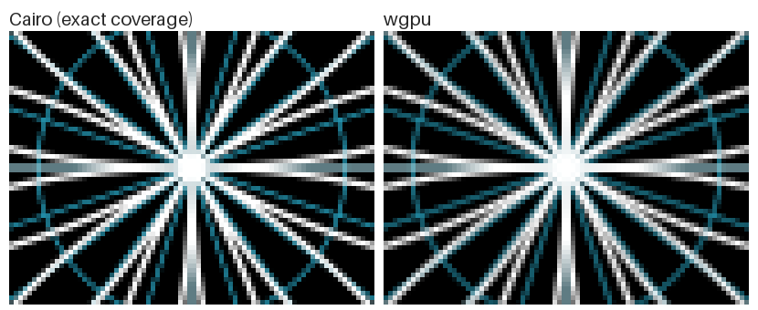
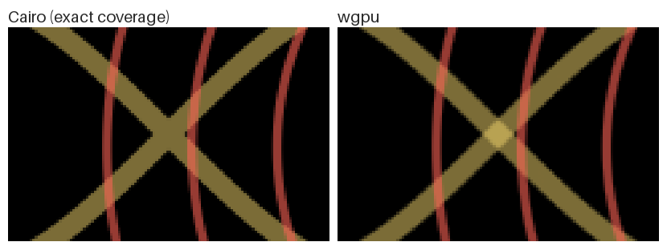
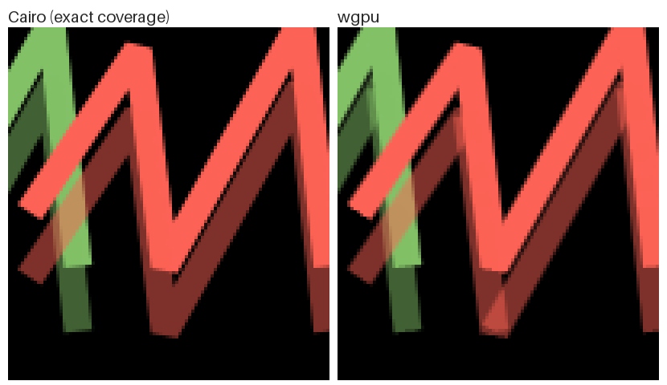
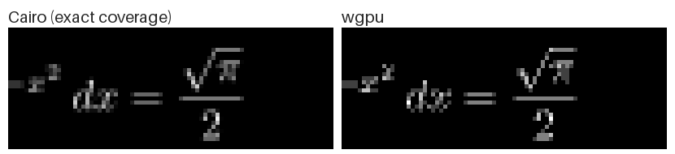

# Edges of strokes and fills

How the vector pass smooths edges, and where it differs from a renderer
with exact coverage (Cairo). The images show Cairo on the left and this
renderer on the right, enlarged, at 480x270 pixels with 4 MSAA samples.

## How edges are drawn

- **Fills** are triangles (lyon, nonzero rule). Their edges are smoothed
  only by MSAA: `RenderConfig.msaa_samples` samples per pixel give that
  many shades along an edge (-1 takes the most the GPU has).
- **Strokes** are ribbons built in the vertex shader. The ribbon is
  widened by one pixel and each fragment fades by how much of its pixel
  the stroke covers (`stroke_coverage` in `shaders/vector.wgsl`), so
  stroke edges are smooth at any sample count. Every stroke is therefore
  blended (`strokes.rs`).
- The pieces of one object share one depth, and the vector pipelines test
  depth with "less or equal" (`render/draw/geometry/vectors.rs`): where a
  stroke crosses itself, its covered inside draws over its own faded edge.

## Where it differs

**Opaque strokes crossing themselves** look as with exact coverage.

**Translucent strokes crossing themselves** blend over themselves: the
crossing is brighter, as if two strokes crossed. Exact coverage counts
the stroke once.

**Joints of translucent strokes** show the same double blend where the
joint overlaps the ribbons next to it. Joints and caps are not faded by
coverage, only smoothed by MSAA, so miter tips look harder than the
ribbons.

**Small fills**, such as text a few pixels high, get only as many edge
shades as MSAA samples, so glyphs look coarser than with exact coverage.
More samples (`msaa_samples=-1`) help.

## Why not exact coverage

Exact coverage needs a shape's whole coverage before its color is
blended once, for example:

- *stencil, then cover*: mark the samples a stroke covers, then paint
  each marked sample once. Skia does this for strokes whose result
  depends on what is below them
  ([`StrokeTessellateOp.cpp`](https://skia.googlesource.com/skia/+/main/src/gpu/ganesh/ops/StrokeTessellateOp.cpp)).
  It removes the double blend but stays at MSAA quality.
- *coverage counting*: sum each shape's exact coverage into an atlas,
  then paint it once
  ([Skia CCPR](https://skia.googlesource.com/skia/+/1a325d25b941ef801b3e9b2c0342da43cf35cdba),
  [Path rendering by counting pixel coverage](https://www.tdcommons.org/dpubs_series/525),
  [Vello sparse strips](https://skia.googlesource.com/external/github.com/linebender/vello/+/bf5b0f968356bec23fefe76e715e2f91502893eb/sparse_strips/vello_hybrid/README.md)).

Both add passes per shape and a different vector pass. This renderer
keeps one pass that shares depth with the 3D meshes and stays fast; a
renderer that needs exact 2D coverage can be written against the same
`Renderer` interface.
